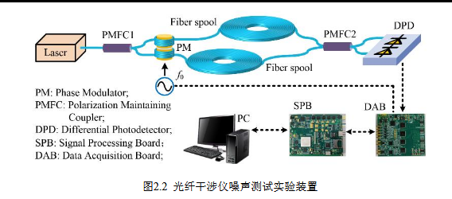

> 本笔记由桌面“个人阅读笔记.md”完整迁入，仅调整库内图片路径，并补充导航与本次可读取对话。内容为 AI 教学整理；论文原文结论、参考数值与假设示例沿用正文标注。未开展新测验，掌握度未评估。

## 阅读导航

- [[#2026-10-29｜保偏 M-Z 光纤干涉仪的三种降噪机制及课题联系|三种降噪机制、噪声公式与课题联系]]
- [[#图2.2 光纤干涉仪噪声测试实验装置|光路图与逐部件说明]]
- [[#M-Z 干涉仪的干涉光功率与光电流关系|秋千类比、电场推导、PD 与 PM]]
- [[#本次对话补充：响应度与论文中的 m²|响应度与 m² 的读法]]
- [[MZ干涉仪降噪原理_对话记录|原聊天返回正文与三张上传图片]]
- 相关论文：[[田帅飞_宽频带超高灵敏三分量光纤地震观测_阅读笔记]]

---

# 个人阅读笔记

## 2026-10-29｜保偏 M-Z 光纤干涉仪的三种降噪机制及课题联系

### 1. 核心结论与证据边界

保偏 Mach–Zehnder（M-Z）干涉仪通过三个不同环节改善相位读出：**透射式光路降低一次背向散射进入探测端形成寄生干涉的机会；互补输出结合平衡差分抑制共模光强噪声；全保偏光路稳定两臂偏振重叠，减轻干涉衰落与偏振相关读出误差。**

三者减少的是不同噪声通道，不能理解为“所有噪声消失”，也不能仅凭光路结构推断测量精度。对学位课题“高性能小型化光纤水下矢量传感仓性能测试与优化”，最终应比较目标频带内的等效输入加速度噪声，并同时考察带宽、方向性、稳定性与封装后的性能。

证据状态：本节是依据用户指定讨论主题、本地既有阅读笔记和外部原始技术资料整理的学习解释，**不是原对话逐字复刻，也不是样机实验结论**。原聊天读取结果中的助手回答仅有引用占位符，无法核对此前每轮选项 B 的题干与判定。本地阅读笔记是二次整理材料，不能替代论文原文。

### 2. 透射式结构：降低背向散射寄生干涉

M-Z 的主信号沿两臂向前传播，在输出耦合器处合束。一次瑞利背向散射光主要向输入端返回，理想光路中不会直接与前向主光一起到达输出探测器。因此，相比主信号本身往返传播的反射式结构，透射式 M-Z 可降低一次背散射导致的寄生干涉。[1]

这是传播方向与探测端位置带来的优势，**不是光纤不再产生瑞利散射**。双重瑞利散射可使光再次转为前向传播；端面反射、连接器回反、器件内部反射也可能使杂散光重新进入探测通道。只要其相干性、偏振重叠及探测带宽允许，仍可能产生寄生拍频或相位误差。[1][2]

对百米级绕纤结构：应检查接头与端面的回波损耗、隔离与终端处理、实际光路拓扑，以及弯曲和封装引入的损耗。不应写“透射式结构消除了百米光纤的背散射噪声”，也不能把其他论文长臂系统的噪声大小直接套用到本课题。

### 3. 互补输出与平衡差分：抑制共模 RIN

设输出耦合器理想且为 50:50，两臂在合束器前的光功率为 P₁、P₂，相位差为 φ，偏振和相干性等因素形成的可见度因子为 γ，且 0≤γ≤1。两个输出功率为：

$$
P_\pm=\frac{P_1+P_2}{2}\pm\sqrt{P_1P_2}\,\gamma\cos\phi.
$$

定义两路输出总功率 PΣ=P₁+P₂，总条纹可见度 V=2√(P₁P₂)γ/(P₁+P₂)，则：

$$
P_\pm=\frac{P_\Sigma}{2}(1\pm V\cos\phi),\qquad
P_d=P_+-P_-=P_\Sigma V\cos\phi.
$$

互补表示相位引起的光强变化一增一减。两路相减后，相位信号保留，共同的直流背景抵消。若两探测器响应度均为 R，跨阻增益为 G，则电压输出为 v_d=GRP_d；实际系统需校准两通道增益、频率响应和延迟。[3]

设光源相对功率波动为 x(t)，PΣ=P̄Σ[1+x(t)]。在正交点 φ=π/2+δφ、|δφ|≪1 附近：

$$
P_d\approx-\bar P_\Sigma V\,\delta\phi
-\bar P_\Sigma V\,x\delta\phi.
$$

理想条件下，不含 δφ 的一阶共模强度波动被抵消；但乘性项 xδφ 仍在。若工作点偏离正交点，还会出现与 x cosφ₀ 成正比的残余强度噪声；通道不平衡也会泄漏 RIN。因此，**差分抑制 RIN 有条件，不能将上式解释成任意工作点下 RIN 都完全抵消**。

RIN 的线性功率谱密度及其分贝形式为：

$$
\mathrm{RIN}(f)=\frac{S_{\delta P}(f)}{\bar P^2}
\quad[\mathrm{Hz}^{-1}],\qquad
\mathrm{RIN}_{\mathrm{dBc/Hz}}=10\log_{10}\!\left(\frac{\mathrm{RIN}(f)}{1\,\mathrm{Hz}^{-1}}\right).
$$

工程限制：需要匹配光功率、探测响应与频响，避免饱和；共模抑制比 CMRR 随频率变化。差分不能抵消已经表现为两臂相位差的噪声，也不能消除独立散粒噪声与电子噪声。对于普通相干光、独立探测事件，差分电流的单边散粒噪声 PSD 为 2q(I₊+I₋)，其中 q 为元电荷。[3][4]

上述正交点公式仅解释小信号直接读出的机理。若采用 PGC 或其他调制解调，应使用完整解调链的增益和噪声传递函数；不能把固定正交点模型直接当成 PGC 的全部噪声模型。互补输出还可支持归一化 (P₊−P₋)/(P₊+P₋)，理想模型下可去除共同功率因子，但实际归一化仍受两通道噪声与失配限制。

### 4. 全保偏光路：稳定偏振重叠，减少衰落

令两臂输出的归一化 Jones 偏振矢量为 e₁、e₂，则干涉交叉项包含：

$$
P_{\mathrm{int}}\propto
2\sqrt{P_1P_2}\,|\mathbf e_1^\dagger\mathbf e_2|
\cos\!\left[\phi+\arg(\mathbf e_1^\dagger\mathbf e_2)\right].
$$

因此，偏振变化可能同时改变条纹幅度和附加相位。两臂偏振接近正交时，重叠模接近零，干涉可见度下降；相位读出斜率降低，同样的探测噪声会换算成更大的等效相位噪声。

保偏光纤通过较强双折射形成两条主轴，降低轴间随机耦合。线偏振光正确沿一条主轴入射，且光源尾纤、耦合器、连接器、熔接点与两臂均正确对轴，才有利于稳定合束时的偏振关系。[5]

**保偏不等于保持任意输入偏振，也不等于没有双折射。** 两轴同时受激时，其相对相位仍可能随温度与应力变化。实际系统还存在有限消光比、熔接角度误差、弯曲与扭转串扰、偏振相关损耗等。小型化绕纤和灌封后的应力尤其需要实测。全保偏能够减小偏振相关噪声，不能宣称完全消除，也不能消除真实的温度、压力或机械应变导致的光程变化。

### 5. 从相位噪声到等效输入加速度噪声

本节统一使用频率 f（Hz）和单边功率谱密度。以 Sφ 表示相位噪声 PSD，以 Nφ 表示其幅度谱密度（ASD），避免与灵敏度符号混淆：

$$
N_\phi(f)=\sqrt{S_\phi(f)}
\quad[\mathrm{rad}/\sqrt{\mathrm{Hz}}].
$$

若解调电压到相位的小信号传递函数为 Kφ(f) [V/rad]，则输出噪声折算为：

$$
N_\phi(f)=\frac{N_v(f)}{|K_\phi(f)|}.
$$

直接正交读出理想情况下 |Kφ|=GRP̄ΣV。实际需包含解调算法、滤波及电子链路。可见度降低，意味着 Kφ 变小；但噪声改善幅度仍需结合 Nᵥ 的变化判断。

加速度到两臂相位差的频率响应定义为：

$$
H_{\phi a}(f)=\frac{\Delta\phi(f)}{a(f)}
\quad[\mathrm{rad}/(\mathrm{m/s^2})].
$$

在噪声可折算到该输入、系统线性且标定有效的条件下：

$$
S_{a,\mathrm{eq}}(f)=\frac{S_\phi(f)}{|H_{\phi a}(f)|^2},\qquad
N_{a,\mathrm{eq}}(f)=\frac{N_\phi(f)}{|H_{\phi a}(f)|}
\quad[(\mathrm{m/s^2})/\sqrt{\mathrm{Hz}}].
$$

如果标定灵敏度 Hφ,a_g 的单位为 rad/g，则 Nφ/|Hφ,a_g| 的单位为 g/√Hz。这里 a_g=a/g₀、g₀=9.80665 m/s²；两种加速度 ASD 相差 g₀ 倍，不能混用。

**仅作计算示例**：取用户提供的师兄参考灵敏度 8013.8 rad/g，并假设某频率处相位 ASD 为 1 μrad/√Hz，则：

$$
N_{a,\mathrm{eq}}\approx1.25\times10^{-10}\ \mathrm g/\sqrt{\mathrm{Hz}}
\approx1.22\times10^{-9}\ (\mathrm{m/s^2})/\sqrt{\mathrm{Hz}}.
$$

这里的 1 μrad/√Hz 是假设值，8013.8 rad/g 是参考值，**结果不是本课题样机的已测性能**。静态灵敏度或一个频点的标定值不能代替全频段传递函数。

频带内等效加速度均方根噪声应由 PSD 积分：

$$
a_{\mathrm{rms}}=
\left[\int_{f_1}^{f_2}N_{a,\mathrm{eq}}^2(f)\,df\right]^{1/2}.
$$

只有近似白噪声且通带近似矩形时，才可近似为 Nₐ√(f₂−f₁)；实际滤波需计入频响或等效噪声带宽。ASD 不是某个确定的“最小可测加速度”：检测阈值还取决于测量时间、带宽、检测规则和所需信噪比。

### 6. 与盘式加速度计和水下矢量传感仓的联系

对本课题盘式部件，可按“输入加速度—质量块惯性力—盘片应变—绕纤光程变化—两臂相位差—解调—加速度标定”理解信号链。前三项光路措施主要改善光学读出；机械结构决定的响应、封装耦合和交叉轴响应仍需单独验证。

对固定真空波长 λ、单程传播、小应变，光弹效应用有效系数 pₑ 近似时：

$$
\Delta\phi_\mathrm{strain}
\approx\frac{2\pi n_\mathrm{eff}}{\lambda}(1-p_e)
\left[\int_{L_1}\epsilon_\parallel(s)\,ds-
\int_{L_2}\epsilon_\parallel(s)\,ds\right].
$$

该式假设光纤与结构应变传递有效；保偏纤的有效光弹参数与所用轴有关，横向应变、胶层、滑移、温度和压力效应可能需要更完整模型。不能把机械 ΔL 简单等同于光程变化而漏掉折射率变化。

轴对称小变形模型中，环向应变 εφφ=uᵣ/r。对近似圆周绕纤的一圈，ΔL≈2πrεφφ；整段螺旋绕纤应沿实际路径积分，螺旋角不可忽略时应用沿纤方向应变。两臂分别对应盘片上、下表面且形成等幅反向应变时，推挽差分可增强相位响应；**不能在未知绕纤分配与传递效率时直接乘 2**。

用户提供的光纤 260 m、参考固有频率约 282 Hz、参考灵敏度约 8013.8 rad/g，均仅作为部件级对照线索；260 m 的总长/单臂/双臂分配待原文核对。固有频率不是可用平坦带宽，参考数字接近也不是模型正确的证明。

整仓还会引入壳体与内部支撑模态、静水压力预载、灌封与夹持变化、声压串扰、安装方向误差及轴间耦合。多轴系统应标定传递矩阵，而非仅列三个独立常数：

$$
\boldsymbol\phi(f)=\mathbf H_{\phi a}(f)\mathbf a(f)
+\boldsymbol\eta(f).
$$

必要时加入声压和温度等交叉输入项。矩阵求逆或解耦可能放大噪声；单轴标定不能直接证明整个矢量仓的方向测量精度。

### 7. 剩余噪声与核查清单

三种措施实施后，仍需考虑激光频率噪声、光纤热力学涨落、环境温漂、机械热噪声、外界振动、散粒噪声、电子噪声，以及调制与解调误差。

#### 第二章噪声：学习层次

| 学习层次 | 噪声 | 学习要求 |
|---|---|---|
| 重点掌握 | 光源频率噪声、光纤热噪声 | 理解机制、核心关系与适用条件 |
| 理解原理 | 光源相对强度噪声 RIN | 理解强度波动与平衡差分的部分抑制 |
| 简单了解 | 散粒噪声、量化噪声、电路热噪声 | 记住来源与常见改善方向 |

*本次整理依据用户提供的第二章总结，属于 AI 精炼学习笔记；未重新核验论文全文，也不是实验结果。以下 $\nu$ 为光学频率，$f$ 为噪声分析频率，$S_\phi$ 为相位 PSD。*

例如两臂差分群时延为 Δτ，忽略其他色散与路径效应时，激光频率噪声 ASD Nν 的相位耦合为：

$$
N_{\phi,\nu}(f)=\frac{2|\sin(\pi f\Delta\tau)|}{f}\,N_\nu(f)
\approx2\pi|\Delta\tau|\,N_\nu(f)
\quad(f|\Delta\tau|\ll1).
$$

低频近似中 Δτ≈n_gΔL/c，n_g 为群折射率。两臂都很长，不等于臂差很大；应测差分时延及其温漂。平衡差分和全保偏并不会自动去掉这类真实相位噪声。[1]

不同噪声若不相关，可将其 PSD 相加；若相关，须计入互谱，不能把各项 ASD 直接相加。噪声底下降也不等于绝对准确度提高：系统误差、标定误差和交叉灵敏度仍需评估。

在忽略色散、两臂折射率相同且频率扰动相对传播时延足够缓慢的近似下：

$$
\phi=\frac{2\pi nL}{\lambda_0}=\frac{2\pi nL\nu}{c},\qquad
\boxed{\delta\phi=\frac{2\pi n\Delta L}{c}\,\delta\nu}.
$$

这里 $\lambda_0=c/\nu$ 为真空波长，$\Delta L=L_1-L_2$。固定臂长差时，光源频率波动会变成差分相位噪声；不是只有长度变化才会改变相位。相同光源、上述近似内，臂长差增大 10 倍，相位 ASD 增大 10 倍、PSD 增大 100 倍。应减少不必要的臂差；精确处理沿用上面的群时延模型，不能把相位折射率与群折射率混用。

#### 光纤热噪声与读出噪声

- **热传导噪声**：光纤内部温度涨落通过热光效应改变折射率，通过热膨胀改变长度，两者都改变光程。均匀温度微扰下可写为：

$$
\delta(nL)=L\left(\frac{\partial n}{\partial T}+n\alpha\right)\delta T,
\qquad \alpha=\frac{1}{L}\frac{\partial L}{\partial T}.
$$

  实际温度涨落具有空间分布，差分噪声还取决于两臂相关性；宏观控温不能完全消除微观热涨落。

- **热机械噪声**：材料热运动与机械耗散相联系，引起自发应变、长度及光程涨落。用户所述论文模型在相应频段、其他参数固定时给出趋势：

$$
S_{\phi,\mathrm{TM}}(f)\propto\frac{L}{f},
\qquad \sqrt{S_{\phi,\mathrm{TM}}(f)}\propto\sqrt{\frac{L}{f}}.
$$

  这是该论文模型及其适用频段下的趋势，不是所有光纤与频率范围的通则；具体频段、系数与边界条件待论文原文核验。$L$ 是模型中的受噪光纤长度，不是前述臂长差 $\Delta L$。改善方向是评估材料耗散、绕制、夹持与封装；不能未经验证断言绕得更紧就更安静。

- **RIN**：光源功率的相对波动，经探测和解调可能成为等效相位噪声。平衡差分可部分抑制共同强度分量；通道失配、工作点偏移及乘性波动限制效果。定义与推导见前文“互补输出与平衡差分”，此处不重复。

| 简单了解的噪声 | 来源 | 常见改善方向 |
|---|---|---|
| 散粒噪声 | 光子探测、载流子产生的离散统计涨落 | 在线性与不饱和范围内适当提高探测光功率、提高量子效率；相对噪声可改善，但绝对电流噪声随平均电流增加，差分不消除独立散粒噪声 |
| 量化噪声 | ADC 将连续电压映射到有限数字等级 | 提高有效位数、合理匹配输入幅度与量程；适用条件下用过采样与滤波降低带内噪声 |
| 电路热噪声 | 电阻等耗散元件的热运动产生电压或电流涨落 | 优化电阻与跨阻设计、合理降低温度、限制无用带宽；同时兼顾增益和稳定性 |

#### 总串联关系与等效输入噪声

信号链沿用前文：加速度引起结构应变和差分光程变化，再转为相位、干涉光功率、光电流，经采集解调得到测量结果。光源频率噪声与光纤热噪声改变差分相位；RIN、探测及采集电路噪声经实际读出传递函数折算到相位端。统一折算后，不相关项按前述规则相加为总 $S_\phi(f)$。

与前文符号对应，令 $K_a(f)\equiv H_{\phi a}(f)$，则等效输入加速度噪声 ASD 为：

$$
\boxed{a_n(f)=\frac{\sqrt{S_\phi(f)}}{|K_a(f)|}}
\equiv N_{a,\mathrm{eq}}(f).
$$

$K_a$ 必须是同一频率处的有效标定响应。用 $\mathrm{rad}/(\mathrm{m/s^2})$ 或 $\mathrm{rad/g}$ 标定时，结果分别为 $(\mathrm{m/s^2})/\sqrt{\mathrm{Hz}}$ 或 $\mathrm{g}/\sqrt{\mathrm{Hz}}$；不能用单一静态灵敏度替代整个频带。降低相位噪声与提高有效灵敏度都可能改善输入噪声，应同时比较带宽与封装条件。

建议先用小光路完成以下核查，再扩大绕纤与整仓验证：

| 核查对象 | 设置与记录 | 可支持的结论 |
|---|---|---|
| 平衡差分 | 同光功率、带宽和相位工作状态，比较单端/差分的相位 ASD，测目标频带内 CMRR | 可判断 RIN 抑制；不能仅凭电压谱下降判定，须校准相位增益 |
| 全保偏 | 记录轴对准、消光比、条纹可见度与解调噪声，施加可重复温度/弯曲扰动 | 可判断偏振稳定性；真实应变与温度相位须区分 |
| 寄生干涉 | 控制接头反射与终端，保持其余条件一致，检查噪声变化 | 可给出反射相关性的初步证据；单次谱线变化不能唯一归因于背散射 |
| 部件与整仓 | 分别标定频响、交叉轴响应，记录空气/水下、压力、温度、夹持条件 | 得到适用条件内的灵敏度与等效输入噪声，比较封装前后变化 |

普通实验室“无激励”记录仍含环境振动，不能直接称为本征自噪声；若需分离自噪声，应说明参考传感器、隔振条件或相关测量方法及其假设。

当前状态：**理论机理与单位关系已核对；课题应用为条件性分析；样机降噪量、CMRR、相位噪声、有效带宽及整仓等效输入噪声均未在本次任务中测量。**

### 8. 来源与追溯

- 原讨论入口：[MZ干涉仪降噪原理](chatgpt-conversation://6ae2b66b-ffe4-83e9-aa66-ecf57af5b8a7)。本次能读取用户原始问题；助手正文为引用占位符，未据此声称还原原回答。
- 本地二次阅读笔记：`D:/个人知识库/01-科研/光纤论文阅读笔记/田帅飞_宽频带超高灵敏三分量光纤地震观测_阅读笔记.md`。QMD docid `#ea83fc`，已读取第 1–170 行；重点为第 103–152 行的 M-Z、推挽、灵敏度及噪声关系。此处是已有笔记观点，非本次重新核验的论文逐字结论。
- [1] [Limits and prospects for long-baseline optical fiber interferometry](https://doi.org/10.1364/optica.470430)。原始研究，核对 M-Z 双重瑞利散射残余及臂差导致的激光相位噪声耦合。其具体系统结果不直接外推到本课题。
- [2] [Double Rayleigh scattering in a digitally enhanced, all-fiber optical frequency reference](https://opg.optica.org/viewmedia.cfm?seq=0&uri=oe-29-17-26319)。原始研究，核对透射式设计的一次背散射优势及二次散射限制。
- [3] [An ultra-sensitive balanced detector with low noise for continuous-variable quantum key distribution](https://arxiv.org/abs/1806.03394)。原始研究，支持探测通道匹配与有限 CMRR 的工程限制；其探测器性能不是本课题实测值。
- [4] [Noise spectra in balanced optical detectors based on transimpedance amplifiers](https://arxiv.org/abs/1709.05213)。原始研究，支持平衡探测中的散粒噪声与电子噪声仍须评估。
- [5] [Schäfter+Kirchhoff：Polarization-maintaining Fibers](https://www.sukhamburg.com/support/technotes/fiberoptics/cablebasics/pmc.html)。器件厂商技术说明，核对主轴激励、对轴条件与双轴激励下的偏振变化。

公式中理想互补输出、小信号展开、噪声折算及课题适用性说明为本节教学推导；示例数值和待测事项已单独标注。外部资料核查日期：2026-10-29。

## 图2.2 光纤干涉仪噪声测试实验装置

*原图：用户提供的 image(20261029-063152).png。仅复制并为附件采用便于引用的文件名，未裁剪、重绘或修改像素。以下为读图解释，不是论文逐字引文。追加日期：2026-10-29。*

### 1. 先看清光路与电路

图的上半部分为透射式 M-Z 光路：Laser 发光，经 PMFC1 分为两臂，两臂各有一卷 Fiber spool，其中仅一臂串接 PM；两路在 PMFC2 合束，两个光学输出接入 DPD。图的下半部分为电信号与数据链路：DPD 接 DAB，DAB 与 SPB 相连，SPB 与 PC 相连；f₀ 正弦驱动一方面接 PM，另一方面以虚线连接 DAB。

图中没有给出两卷光纤的长度、耦合比、激光波长、调制深度、f₀ 数值、板卡型号和处理程序。不能把本课题参考光纤长度 260 m 或其他装置参数直接代入本图，也不能仅凭此图把某卷指定为振动敏感臂、另一卷指定为完全不受扰动的参考臂。

### 2. 每个部件的作用

| 图中标识 | 名称 | 在此装置中的作用与读图边界 |
|---|---|---|
| Laser | 激光器 | 提供两臂共同使用的光源。两臂光需在合束时具有足够相干性；激光的强度与频率波动也可能进入噪声测量。图中未标出光源型号、线宽或隔离器。 |
| PMFC1 | 保偏光纤耦合器 1（Polarization Maintaining Coupler） | 将入射激光分成两路，建立 M-Z 的两条干涉臂。保偏设计有助于维持所选主轴上的偏振传输，但仍要求正确入射和对轴。图中未注明实际分光比。 |
| PM | 相位调制器（Phase Modulator） | 仅位于其中一条干涉臂，通过外加电信号主动改变该臂光的相位，从而改变两臂相位差。此处 PM 不是“保偏光纤”的缩写。图示绕纤外形不足以确认其内部实现、材料或型号。 |
| f₀ 与正弦符号 | 相位调制驱动 | 表示以频率 f₀ 的周期电信号驱动 PM，产生已知相位调制。其与 DAB 的连接提示驱动信息可供采集链使用，但图中没有说明是采样参考、触发、时钟同步还是其他接口。 |
| 两卷 Fiber spool | 两臂的长光纤卷 | 分别提供两条较长的传播路径，温度、应力、振动及光纤自身涨落等可改变其光程。探测器最终响应两臂光程变化之差。两臂均长不代表臂差大；线圈也不能未经结构和标定就等同于加速度传感器。 |
| PMFC2 | 保偏光纤耦合器 2 | 将两臂光合束，使相位差转化为干涉光强。理想对称耦合器的两个输出具有互补干涉项，分别送入 DPD；实际效果取决于功率、偏振、相干性与器件参数。 |
| DPD | 差分光电探测器（Differential Photodetector） | 将 PMFC2 的两路光变成电信号并作差。互补干涉信号在差分中保留，共同光强背景与共模扰动可被抑制。两路响应、增益及频响失配会限制抑制效果；差分仍有散粒噪声和电子噪声。 |
| DAB | 数据采集板（Data Acquisition Board） | 接收探测端电信号，将其接入数据采集链，通常涉及采样与数字化；图中还画出了与 f₀ 驱动的连接。图未给出采样率、位数、通道分配及与 SPB 的具体任务划分。 |
| SPB | 信号处理板（Signal Processing Board） | 与 DAB 及 PC 交换数据，承担系统安排的信号处理任务。仅凭名称不能认定其采用 PGC、锁相、FFT、归一化或任何特定算法，也不能判断是否为 FPGA 或 DSP。 |
| PC | 电脑（Personal Computer） | 作为主机与 SPB 通信，可用于实验控制、显示与保存结果；具体软件功能需查实验说明或程序。PC 与 SPB、SPB 与 DAB 的双向箭头表示存在双向通信，不能据此推断协议。 |

### 3. 整体信号流程：光相位如何变成记录数据

1. Laser 输出激光，PMFC1 将光分成两臂。
2. 两路分别通过长光纤；PM 只对其中一臂加入周期相位调制。环境扰动和光纤噪声同时可能改变两臂的光程。
3. PMFC2 合束，两臂相位差表现为两个输出端的干涉光强变化。
4. DPD 检测两路光并差分，输出包含干涉信息的电信号。
5. DAB 采集信号，SPB 按实际程序处理，PC 接收、显示或保存数据。驱动与采集的连接可提供调制相关信息，但具体用途待原始实验说明确认。

若把有 PM 的一臂定义为第 1 臂，取相位差为第 1 臂减第 2 臂，可以用下式帮助理解：

$$
\Delta\phi(t)=\phi_1(t)-\phi_2(t)+C\cos(2\pi f_0t+\theta_0).
$$

其中 φ₁、φ₂ 表示不含主动调制的两臂相位，C 为调制深度（rad），θ₀ 为驱动初相位。该式假设调制近似正弦，不代表图中已经给出这些参数。若改用相反的相位差定义，调制项符号随之改变。

**PM 的任务是引入已知差分相位，辅助读出；它本身不会自动消除随机噪声。** 这种驱动可用于相位生成载波等读出方法，但有正弦驱动不等于已经证实使用某种 PGC 算法。若两臂施加完全相同的相位调制，共同增加的相位会在相减时抵消。

### 4. 三种降噪机制与图2.2的对应关系

**（1）透射式结构：对应 PMFC1、两条前向传播臂和 PMFC2。** 主光由输入端向输出端传播，一次背向散射主要返回输入方向，因此降低其直接到达输出端形成寄生干涉的机会。长光纤仍产生瑞利散射；双重散射和反射回返仍可能进入探测端。这里的结构优势不等于背散射噪声为零。

**（2）平衡差分：对应 PMFC2 的两个输出和 DPD。** 两端干涉项互补，作差可保留相位信息并抑制共模光强分量，因而有助于降低光源相对强度噪声（RIN）的影响。效果受光功率和探测通道匹配、频率响应及工作状态限制；光源功率波动对干涉幅度的乘性影响仍可能存在。不能据图宣称 RIN 已被完全消除，也不能把“两个光纤卷”误当成执行差分探测的器件。

**（3）保偏设计：对应 PMFC1、PMFC2 及需要配套对轴的两臂光路。** 稳定两臂在合束处的偏振重叠，有助于减少条纹可见度起伏和偏振衰落。图中明确标注的是保偏耦合器；要确认整套装置为“全保偏”，还须核实光源尾纤、PM 尾纤、两卷光纤和所有接续点的保偏规格及轴对准。不能仅凭 PMFC 标记证明整条光路均已保偏。

这三种机制分别针对寄生干涉、共模强度扰动与偏振不稳定。它们相互配合，但不会自动消除两臂差分温漂、真实机械扰动、激光频率噪声或电子噪声。PM 与采集处理链负责辅助读出；其具体噪声表现还取决于调制和处理实现。

### 5. 与课题测试的联系及核验状态

对水下矢量传感仓，应将“机械结构把加速度变成相位差”和“光路把相位差准确读出来”分别验证。本图主要说明读出与噪声测试链路，不能证明盘式加速度计的灵敏度、固有频率或整仓方向性。相位噪声只有结合已标定的加速度—相位频率响应，才能折算为等效输入加速度噪声，具体定义沿用前文。

来源与状态：部件名称和连接依据本节嵌入原图；三种降噪机制沿用前文已列出的理论解释与来源。本节公式为教学模型。**已核对原图标识、单臂 PM 和连接关系；具体板卡算法、全光路保偏规格及实验降噪量未由本图验证。**

---

## M-Z 干涉仪的干涉光功率与光电流关系

*追加日期：2026-10-29。以下为教学解释与理想模型推导；论文截图中 $P_0$ 的定义按本次用户描述讨论，未重新核验截图全文。*

### 1. 两个人推秋千：相位决定“配合程度”

把两路光相遇想成两个人推同一个秋千：

- **同步推**：作用方向一致，秋千摆得更大，对应相长干涉。
- **反向推**：一个往前、一个往后，作用互相抵消，对应相消干涉。两人“力气”相等，才可能完全抵消。
- **错开四分之一个周期**：既不是同步，也不是完全反向，对应 $90^\circ$ 相位差，输出处于明暗中间。

这只是帮助记忆的类比。光干涉实际叠加的是**电场**，不是把两束光的功率直接相加，也不是套用机械推力公式。

### 2. 余弦项从哪里来？

同一探测位置，两束同频、同偏振的电场可写成：

$$
E_1(t)=A_1\cos(\omega t),\qquad
E_2(t)=A_2\cos(\omega t+\varphi).
$$

$A_1,A_2$ 是电场振幅，$\varphi$ 是相位差。先叠加电场：

$$
E(t)=E_1(t)+E_2(t).
$$

光功率与电场平方的光学周期平均值成正比。用同一个常数 $K$ 包含介质和有效探测面积等因素：

$$
P=K\langle E^2\rangle
=K\langle E_1^2+E_2^2+2E_1E_2\rangle.
$$

利用：

$$
\langle\cos^2(\omega t)\rangle=\frac12,\qquad
\langle\cos(\omega t)\cos(\omega t+\varphi)\rangle
=\frac12\cos\varphi,
$$

得到：

$$
P=\frac K2(A_1^2+A_2^2)+KA_1A_2\cos\varphi.
$$

分别只保留一路光时，该探测端的功率为：

$$
P_1=\frac K2A_1^2,\qquad P_2=\frac K2A_2^2.
$$

因此：

$$
\boxed{P=P_1+P_2+2\sqrt{P_1P_2}\cos\varphi.}
$$

**余弦项就是电场平方展开后的交叉项**，反映两路光互相加强还是抵消。合成场振幅满足：

$$
A_{\mathrm{res}}^2=A_1^2+A_2^2+2A_1A_2\cos\varphi,
$$

所以也可以说：**光功率与合成电场振幅的平方成正比。**

适用条件：两束光在探测处充分相干、偏振一致、空间模式重叠；相位差在光学周期平均过程中近似不变。这里的 $P_1,P_2$ 是**经过合束器后对同一输出端的两路功率贡献**，不能直接当成合束器前两臂的功率。

### 3. 理想对称 M-Z：两端一明一暗

假设仅从一个输入端入光，两个耦合器均为理想无损 50:50，两臂等损耗、可见度为 1。将耦合器固定相位并入 $\varphi$，选定端口标号后：

$$
\boxed{P_\pm=P_{\mathrm{avg}}[1\pm\cos\varphi].}
$$

$P_{\mathrm{avg}}$ 是**单端随相位扫描一整周期的平均功率**，不是激光器总输出功率，也不是任意工作状态下的时间平均值。

若干涉仪总输入功率为 $P_{\mathrm{in}}$，理想无损时：

$$
P_{\mathrm{avg}}=\frac{P_{\mathrm{in}}}{2},\qquad
P_++P_-=P_{\mathrm{in}}.
$$

| 相位差 | $P_+$ | $P_-$ |
|---|---|---|
| $0^\circ$ | $2P_{\mathrm{avg}}=P_{\mathrm{in}}$，最亮 | $0$，最暗 |
| $90^\circ$ | $P_{\mathrm{avg}}=P_{\mathrm{in}}/2$ | $P_{\mathrm{avg}}=P_{\mathrm{in}}/2$ |
| $180^\circ$ | $0$，最暗 | $2P_{\mathrm{avg}}=P_{\mathrm{in}}$，最亮 |

对 $+$ 端而言，三行分别对应“同步推”“错开四分之一周期”“反向推”。**暗端的能量没有消失，而是重新分配到亮端。** 交换端口编号或相位零点，明暗标号会交换，互补关系不变。

$90^\circ$ 附近功率对相位的斜率最大，适合读出小相位变化；最亮、最暗点的斜率为零，小扰动的一阶响应较弱。

### 4. PD：把明暗按比例变成电流

固定波长、在线性工作区、忽略暗电流等偏置，并在有效响应带宽内，PD 的信号光电流满足：

$$
\boxed{i=RP.}
$$

$R$ 是光电响应度，单位为 $\mathrm{A/W}$；$P$ 用 $\mathrm W$，$i$ 就是 $\mathrm A$。例如 $R=0.8\ \mathrm{A/W}$、$P=1\ \mathrm{mW}$，则 $i=0.8\ \mathrm{mA}$。这只是算例，不代表本装置参数。

两路 PD 响应度相同，令 $i_0=RP_{\mathrm{avg}}$，就有：

$$
\boxed{i_\pm=i_0[1\pm\cos\varphi].}
$$

**光功率怎样随相位变化，光电流就按比例跟着变。** 电流随 $\cos\varphi$ 变化，并非直接正比于 $\varphi$。PD 平均掉光学载频的快速振荡，读出带宽内的功率变化。

理想差分电流为：

$$
i_{\mathrm{diff}}=i_+-i_-=2i_0\cos\varphi.
$$

实际差分效果受通道匹配影响；输出电压还取决于跨阻增益和电路频响，不能直接把电流公式当作电压公式。

### 5. PM：给其中一臂加入已知“节拍”

本光路中的 PM 指**相位调制器**，它通过外加驱动改变其中一臂的相位，从而改变两臂相位差：

$$
\varphi(t)=\varphi_{\mathrm{bias}}
+\varphi_{\mathrm{vib}}(t)+\varphi_{\mathrm{noise}}(t)
+C\cos(2\pi f_0t+\theta_0).
$$

$C$ 为调制深度，单位 rad；$f_0$ 为调制频率。把这个相位代入上面的功率、电流公式，就得到随时间变化的输出。正弦相位调制并不保证光功率是纯正弦波，余弦的复合还可能产生谐波。

PM 像给一位“推秋千的人”加入已知节拍，辅助后续读出；它本身不自动消除随机噪声。若两臂加上完全相同的相位变化，共同项会在相位差中抵消。

### 6. 从振动到电流的完整链路

**振动 → 结构与光纤应变 → 两臂光程差变化 → 相位差变化 → 干涉光功率变化 → 光电流变化 → 采集与解调。**

固定真空波长 $\lambda_0$、单程传播时，定义两臂光程差：

$$
D(t)=\int_{L_1(t)}n_{\mathrm{eff},1}(s,t)\,ds
-\int_{L_2(t)}n_{\mathrm{eff},2}(s,t)\,ds.
$$

振动引起光程差变化 $\delta D$，对应：

$$
\varphi_{\mathrm{vib}}(t)=\frac{2\pi}{\lambda_0}\delta D(t).
$$

光程同时包含长度和有效折射率；应变导致的折射率变化也应计入。若振动让两臂光程等量同向变化，差分响应可能很小。结构怎样把振动转成差分光程，需通过结构设计与标定确认。

### 7. 论文里的 $P_0$：先看定义，再看系数

按本次描述，论文截图把 $P_0$ 称为“激光器输出光功率”。**如果它就是干涉仪的总输入功率**，理想无损 50:50 M-Z 的单端应为：

$$
\boxed{P_\pm=\frac{P_0}{2}[1\pm\cos\varphi].}
$$

若写成 $P_\pm=P_0[1\pm\cos\varphi]$，则 $P_0$ 应表示单端平均功率，或者另有归一化定义；否则两端相加得到 $2P_0$，与总输入功率为 $P_0$ 的无损条件不符。

同理，$P_0$ 表示总输入功率时，两路相同响应度 PD 的基准电流为 $i_0=RP_0/2$。激光器到干涉仪入口之间若有损耗，还要区分激光器输出功率和实际入射功率。**未核对全文定义前，应记为待核查的归一化或系数问题，不能直接断言论文错误。**

实际系统还受插入损耗、分光比、两臂功率不平衡、相干性与偏振重叠影响。单端条纹常写成：

$$
P=P_{\mathrm{avg}}[1+V\cos\varphi],\qquad
V=\frac{P_{\max}-P_{\min}}{P_{\max}+P_{\min}}.
$$

$V$ 是干涉可见度，理想值为 1；$V<1$ 时暗端一般不能降到零。两端存在不对称损耗时，应分别标定平均功率和可见度，不能强行套用同一个 $P_{\mathrm{avg}}$ 的互补公式。

**一句话总结：M-Z 让两臂电场按相位“合力或抵消”，把振动造成的相位差变成明暗变化，PD 再把明暗按响应度变成电流；读公式时先弄清功率符号和理想条件。**

## 本次对话补充：响应度与论文中的 m²

原聊天还讨论了“光电流是否总是使用同一公式”。对常见无内部增益的光电二极管，固定波长、线性区、忽略偏置时：

$$
i=RP,\qquad R=\frac{\eta e\lambda_0}{hc}.
$$

其中 $\eta$ 是量子效率，$e$ 是元电荷，$h$ 是普朗克常数，$c$ 是真空光速，$\lambda_0$ 是真空波长。不同探测器的响应度、带宽、增益与饱和条件不同，不能把某篇论文的全部系数照搬到所有系统。

聊天中引用的论文式子为：

$$
i_0=\frac{m^2P_0\eta\lambda_0 e}{hc}.
$$

从代数看，它相当于 $i_0=R(m^2P_0)$。**这只能说明该表达式把 $m^2P_0$ 作为相应的功率因子；不能据此确定 $m$ 是损耗、分光比或调制深度。** 其具体定义须核对论文符号表、上下文与截图，不擅自补义。

术语统一：前文一般两束光公式中的 $\gamma$ 表示相干与偏振等交叉项因子；通常实验条纹可见度为 $V=2\sqrt{P_1P_2}\gamma/(P_1+P_2)$。原对话曾用 $V$ 乘在一般交叉项前，该处应理解为交叉项因子，两臂功率不等时不能直接把它当作总条纹可见度。

### 对话范围与学习证据

本次从原聊天接口读取到 5 轮正文，按先后包括：粘贴光路图与解释部件、PD 转换与 $m^2$、干涉功率余弦关系、通俗笔记整理、转入 Work 保存。详见 [[MZ干涉仪降噪原理_对话记录]]。

用户另行引用的 Work 聊天（01a185cd-f8ea-7dc2-af83-185eaf77d319）记录了三种降噪机制的整理与桌面写入，成果已完整保留在本文前部。该任务引用了“第2轮选 B”“第3轮选 B”，但未返回对应完整题干，不能追溯判断答题是否正确，也不据此更新掌握度。

原正文中“助手回答仅有占位符”的说明是此前整理时的访问状态；本次已取得上述 5 轮正文，作为补充归档。更早的讲解未在此次接口结果中返回，不声称已收录整个历史。

一句话复习：先用光路把差分相位变成互补明暗，再由 PD 转成电流；功率归一化、可见度和实际器件条件决定公式能否直接使用。