# 磁珠介绍与手册解读

本次实际学习：**磁珠介绍、磁珠应用案例分析**。沿用既有章节ID B05，正文按PPT顺序整理；手册与工程补充另标，不扩展为未学章节。课堂笔记不等于测验答案，目前**尚未进行本节测验**。

## 看课对照表

| PDF页序 | 课程内容 | 本笔记位置 |
|---|---|---|
| 48–50 | 课程入口、实物/线路位置、电容与磁珠滤波比较 | 第一部分及案例 |
| 51–52 | 噪声抑制机理与应用场合 | 第一、二部分 |
| 53 | 尺寸、阻抗、DCR、电流、温度 | 第三部分 |
| 54–55 | Z/X/R曲线、100 MHz参数与替代判断 | 第四部分 |
| 56 | 与电感的区别 | 第二部分 |
| 58–59 | 曲线应用、电容模型与去耦回路 | 第五部分 |
| 60–61 | 有源晶振供电、FPGA电源实例 | 第六部分及案例分析 |

重点配套文档《电感、磁珠基础及在公司实际工作中的应用》：第8–10页说明原理/选型，第11–12页为**2.5实例**，第12–13页比较磁珠与电感。页码均为PDF页序。

## 第一部分：磁珠为什么能抑制噪声（49–52页）

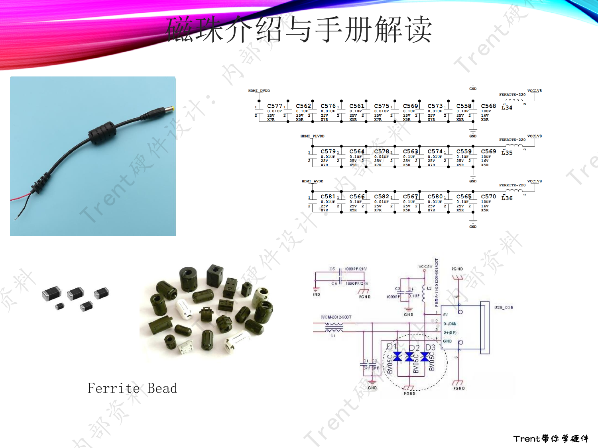

**看图重点：** 左侧先认实物，右侧看它串在什么线路；原理图沿用电感状符号不代表器件就是储能电感。来源：基础篇-03.pdf第49页。

**磁珠常串联在线路中，在合适的高频段利用铁氧体损耗将部分噪声能量转化为热；目标是衰减噪声，而非保证噪声完全消失。** 低频时它常表现得更像电感，高频损耗占主导时更像电阻；具体频段看型号曲线。

课堂“消除噪声”强调的是**耗散能量**。有三种作用要分开：

- **旁路**：并接的电容在目标频段提供局部回流通路，使较少噪声电流流向其他电路；地也不是无限的噪声垃圾桶。
- **阻隔/反射**：串联器件改变线路阻抗，减少噪声传输；反射程度取决于源、负载及线路条件。
- **耗散**：磁珠的阻性损耗把部分高频能量变成热。真实电感、电容也有损耗，不能说只有磁珠能发热或耗散。

**纠正原笔记：不是电感和电容都提供低阻抗通路泄放到地。** 常见电源滤波中，电感/磁珠串联，电容对地并联。串联电感在适当频段增加噪声通路阻抗，电容提供局部回路，两者各司其职。

## 第二部分：与电感的区别及应用（52、56页）

| 器件 | 工程上着重利用什么 | 常见用法 |
|---|---|---|
| 功率电感 | 储能、维持电流连续；需要核查偏置、损耗与温升 | DC-DC储能、LC滤波 |
| 磁珠 | 目标频带的阻抗及磁性损耗 | 器件电源支路隔离、信号线EMI抑制 |

这不是“电源只能用电感、信号只能用磁珠”，也不是“电感只能抑制传导、磁珠只能抑制辐射”。本节的两个实际案例恰恰都把磁珠放在**电源线上**。

信号线上还要检查有效波形：方波的边沿依赖较高次谐波，不能只让基频通过就认定信号不受影响；本节晶振案例是串在VCC线上，不是在CLKOUT线上串磁珠。

## 第三部分：参数和规格表怎么读（53页，配套TDK手册）

| 参数 | 读法与选型要点 |
|---|---|
| 指定频率下阻抗 | 例如120 Ω @100 MHz，只是100 MHz处的阻抗幅值，不是直流电阻，更不是全频段都120 Ω |
| Z/R/X频率曲线 | 先定位实际噪声频段，再比较该频带的阻抗、阻性比例及带宽 |
| DCR | 检查直流压降和导体发热，不用100 MHz阻抗代替DCR |
| 额定电流 | 检查厂家测试与温度条件、实际电流及余量；承载电流合格，不代表偏置后仍有足够滤波阻抗 |
| 温度范围及降额 | 区分工作温度范围与额定电流降额曲线，按具体系列核查 |
| 封装、材质与允差 | 同尺寸、同100 MHz阻抗，也可能频率响应不同；必须读完整料号 |

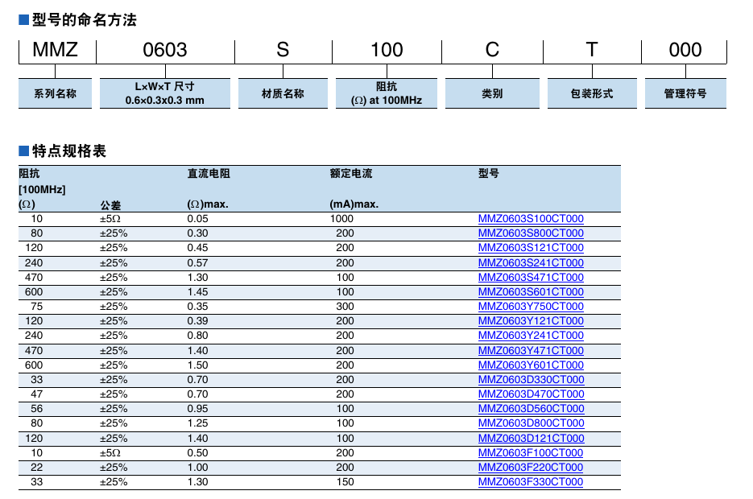

**看图重点：** 同一型号行横向读阻抗、DCR和额定电流；上方命名图用于核对公制0603及材质代码。来源：MMZ0603普通版手册第1页，局部提取，原表数值不变。

**TDK MMZ0603手册实例（2019-04-24版，第1页）：**

| 完整料号 | 100 MHz阻抗 | DCR最大值 | 额定电流表列上限 |
|---|---:|---:|---:|
| MMZ0603S121CT000 | 120 Ω，±25% | 0.45 Ω | 200 mA |
| MMZ0603Y121CT000 | 120 Ω，±25% | 0.39 Ω | 200 mA |
| MMZ0603D121CT000 | 120 Ω，±25% | 1.40 Ω | 100 mA |

三个都是120 Ω @100 MHz，**不能据此直接等效替换**。还要比较各自频率曲线、直流压降和电流条件。这一系列的“0603”表示约**0.6×0.3 mm的公制尺寸**，不要直接套用电阻常见英制0603的尺寸。

### 小电流能不能不看DCR？

不能先省略参数，应先做数量级估算，再判断其影响能否忽略：

$$\Delta V_{\mathrm{DC}}\approx I_{\mathrm{DC}}R_{\mathrm{DC}},\qquad P_{\mathrm{DC}}\approx I_{\mathrm{DC}}^2R_{\mathrm{DC}}.$$

**教学假设：** 采用1.5 Ω作为DCR估算值，10 mA时压降15 mV、导体损耗0.15 mW；100 mA时压降150 mV、损耗15 mW。热量不一定很大，但低压敏感负载可能不能接受150 mV压降。实际还要考虑DCR温度变化、交流损耗和厂家额定条件。

另外，直流偏置可能使高频阻抗降低，即使没有超过额定电流，也要检查带偏置曲线。不要把某篇应用笔记中的电流利用比例当作所有磁珠的统一规则。

### 低温和高温怎样核查？

本地TDK MPZ1005手册第1页显示：该系列在所示低温区间额定电流曲线平坦，产品温度高于85 ℃后需要降额。因此，**不能概括为“磁珠低温时通流能力必然下降”**。低温系统故障需要一并看电源启动、负载需求、磁珠及PCB压降和器件参数。

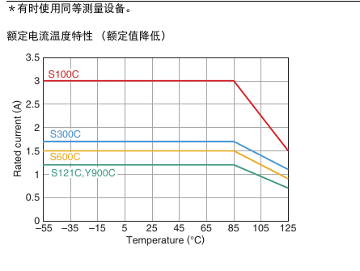

**看图重点：** 不同料号对应不同曲线；本系列所示曲线在85 ℃之后下斜，不支持“低温额定电流必然降低”的概括。它是电流降额图，不是阻抗随温度变化图。来源：MPZ1005普通版手册第1页。

## 第四部分：本节重点——Z、R、X曲线（54–55页）

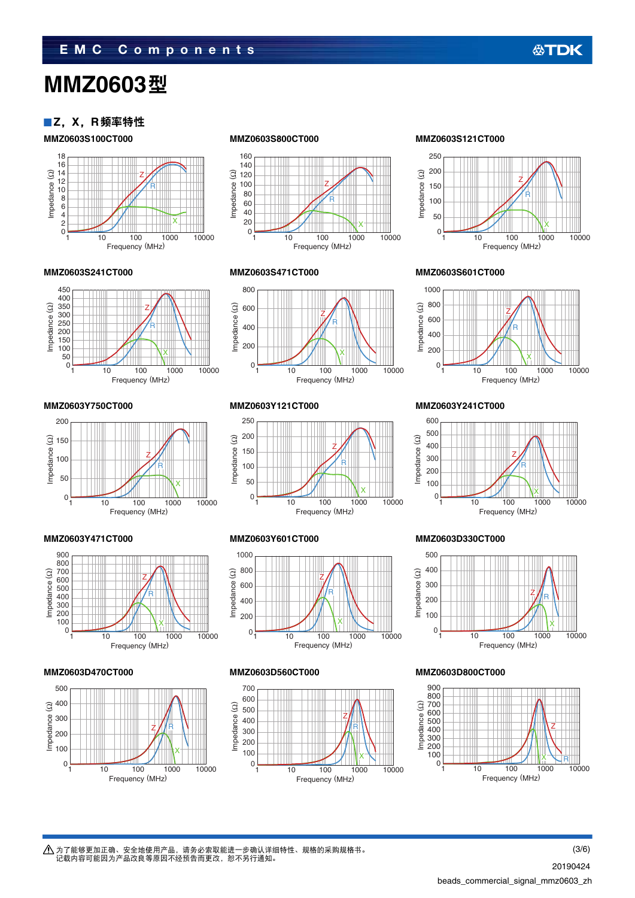

| 曲线 | 含义 | 用途 |
|---|---|---|
| Z | 图中通常为阻抗幅值 \(\lvert Z\rvert\) | 判断目标频点有多大阻碍 |
| R | 等效阻性损耗分量 \(R(f)\) | 判断能量耗散作用；不是DCR曲线 |
| X | 电抗分量；感性区为正，容性区为负 | 判断储能/寄生主导及相位趋势；只画正值的图不能完整判断符号 |

$$Z(f)=R(f)+jX(f),\qquad |Z(f)|=\sqrt{R(f)^2+X(f)^2}.$$

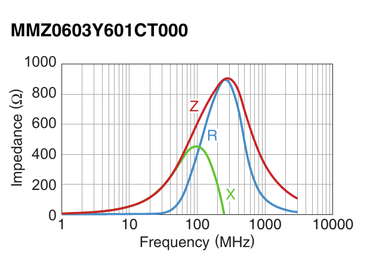

**看图重点：** 红Z、蓝R、绿X。分别找蓝绿相交附近、红线峰值和绿线趋近零的位置，三者不能混为一点。图中X仅显示非负区域，不能从这张截图直接确认更高频的负电抗。来源：同一TDK手册第3页局部放大，曲线和坐标未改。

### 1. R与X的交点：感性与阻性占比的分界参考

在感性区，R与X相等时，对应的交越频率可作为“由感性占优转向阻性占优”的参考。**它不是滤波器截止频率，也不是阻抗峰值或自谐振频率。** 交点两边的特性是连续变化，不会突然从纯电感变成纯电阻。

### 2. 噪声应该放在哪个频段？

希望保留的成分所在频段，应尽量低损耗、低压降；希望抑制的噪声频段，应有足够的阻抗，并优先利用阻性损耗占较大比例的区域。要看**一段频带**，不是只选一个交点。

**纠正原话“噪声要在最大阻抗频率之后”：** 不需要。阻抗峰值之前也可有很合适的阻性抑制区；峰值之后若阻抗已明显下降，反而可能抑制不足。源/负载阻抗与旁路电容共同决定实际衰减，单看曲线还不能算出整机滤波效果。

### 3. 阻抗峰值和自谐振怎么区分？

看见Z峰值，可以称为**阻抗峰值频率**；自谐振还涉及电感性与寄生电容的抵消，通常要看X过零或相位信息。磁珠损耗大、R与X随频率变化，**不能仅凭Z最高点就严格认定SRF**。厂家明确给出定义时按其说明；简化模型可近似关联，不能混用为普遍精确结论。

在足够高频、寄生电容主导后，磁珠可能呈容性且阻抗下降，滤波能力可能减弱。但不是越过某一点就立刻完全失效，仍以该噪声频带的实际阻抗和整机测试为准。

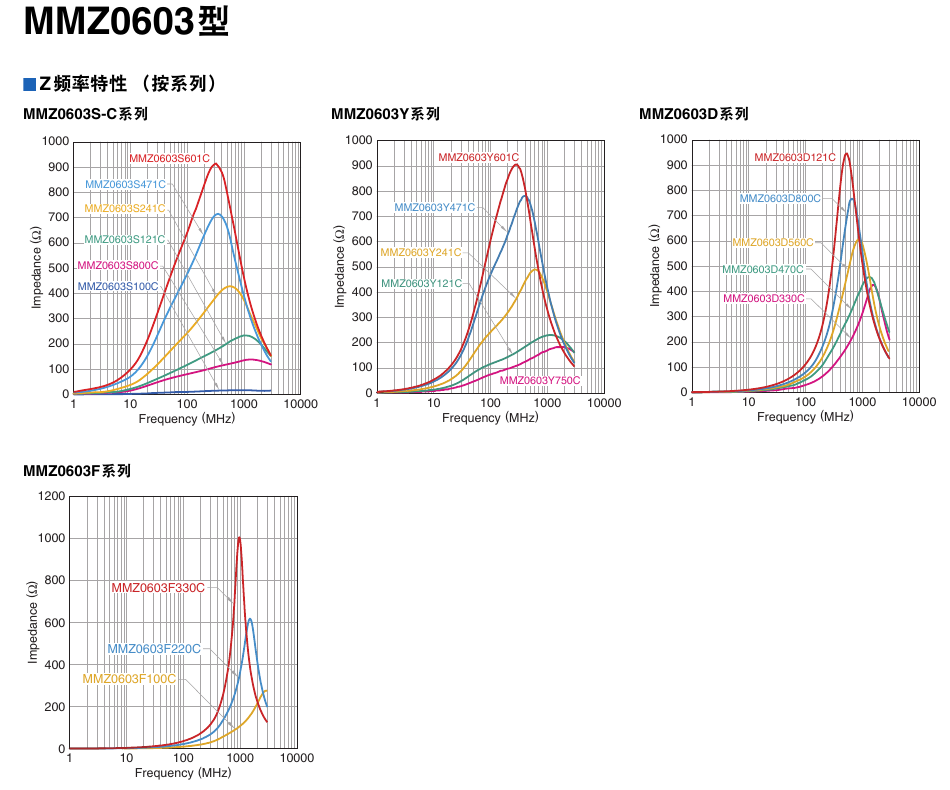

**看图重点：** 比较各型号曲线的上升频段、峰值位置与带宽；选替代料时沿目标噪声频率比较整段响应，不能只比较100 MHz一个点。来源：MMZ0603普通版手册第2页。

## 第五部分：磁珠与电容配合（58–59页）

常见结构是“电源—串联磁珠—局部负载”，负载侧接去耦电容到地。电容帮助就近提供变化电流，磁珠限制高频噪声流向其他供电支路。它们也可能产生谐振峰，因此加磁珠不保证每个频点都改善。

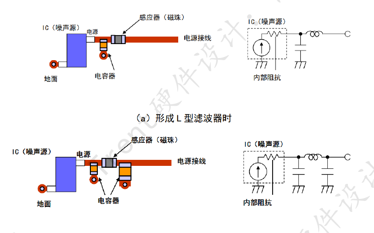

**看图重点：** 左侧为摆放位置，右侧为对应电路；电容对地并联，磁珠在线路上串联。图中左侧IC被画成噪声源，观察的是其噪声向右侧电源接线传播，分析时不要把传播方向看反。来源：基础篇-03.pdf第59页左半部分。

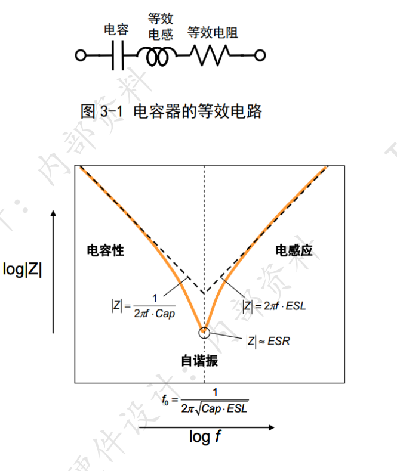

**看图重点：** 这是电容的阻抗谷示意，不能套成磁珠的阻抗峰。高频一侧受ESL影响，说明为什么不能只按容值选高频去耦电容。来源：基础篇-03.pdf第59页右半部分。

关于原笔记“电容越小，滤波频率越高、去耦半径越小”：

- 容抗 \(|X_C|=1/(2\pi fC)\)。**同一频率下，容量越小，理想容抗反而越大**，不能直接说滤波更强。
- 若其他寄生条件相同，较小C的自谐振频率可能更高；实际高频能力还受封装、ESL、ESR和安装回路影响。
- “去耦半径”是布局经验说法，不是只由容量决定的固定圆。需要支持越快的电流变化，通常越应缩短供电及地回流路径、减小回路寄生。不能据容值算一个通用半径。

与既有笔记衔接：[[B03-电容器件手册解读与选型应用]]、[[专题-芯片去耦完整回路与PCB布局]]。

## 第六部分：工程案例入口（50、60–61页；配套文档2.5）

具体图纸和过程分到案例文件，正文只保留结论：

| 案例 | 应带走的结论 |
|---|---|
| [[CASE-2026-10-25-07-有源晶振电源磁珠隔离|有源晶振供电隔离]] | 磁珠在VCC支路，隔离供电串扰；有用供电是直流，不把66 MHz时钟基频直接当电源必须通过的频率 |
| [[CASE-2026-10-25-08-FPGA低温供电压降与磁珠排查|FPGA低温故障]] | 重点是负载端电压预算、磁珠与PCB压降和环境，不从单例推导低温通流的一般规律 |
| [[CASE-2026-10-25-09-磁珠与电容组合滤波对比|电容、磁珠及π型滤波对比]] | 课程图展示组合改善，但衰减值与源/负载、噪声频段和布板条件相关 |

### 案例图预览：先看原理图，再进入详细分析

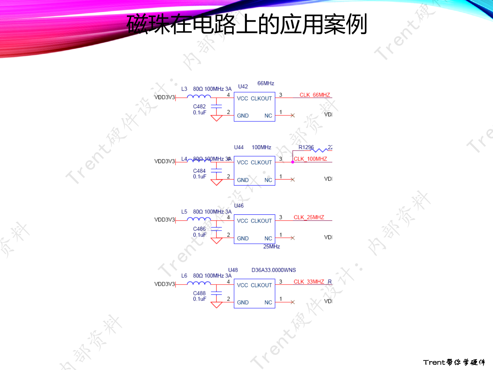

**看图重点：** 沿VDD3V3→L3→U42的VCC读供电路径；CLKOUT在另一侧，磁珠没有串在时钟输出线上。详细见上方有源晶振案例。

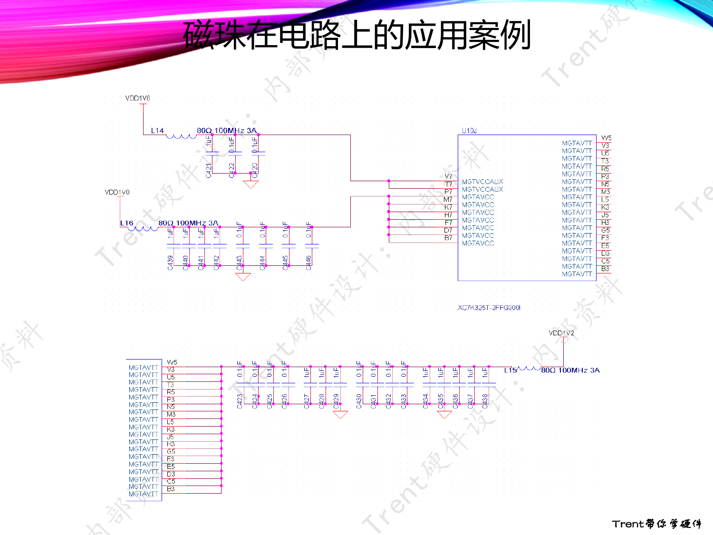

**看图重点：** 分别找三路电源、磁珠和负载侧电容；图与文字叙述的对应差异已在低温案例中保留，不能自行补成同一实测版本。

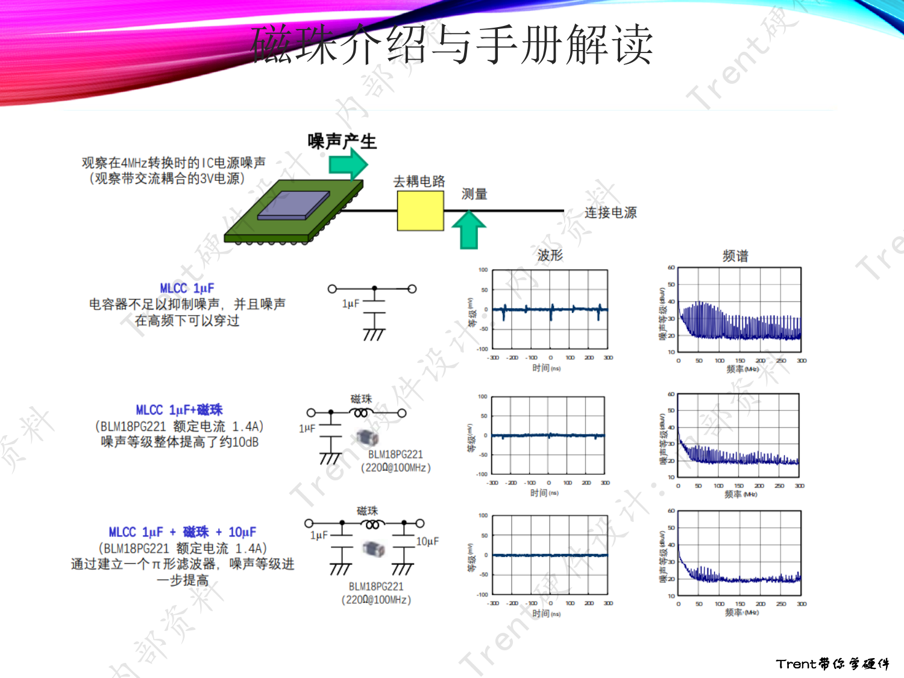

**看图重点：** 从上往下比较波形及频谱，这是特定课堂图的结果，不是任意串磁珠都能获得相同改善。完整边界见组合滤波案例。

## 原笔记的关键校正

| 本人课堂记录 | 保留原意后的准确表达 |
|---|---|
| 磁珠真的能消除噪声 | 在适当频段耗散部分噪声能量、降低传输，不能保证完全消失 |
| 电感和电容都是低阻抗泄放到地 | 区分串联阻隔与并联旁路；实际回流必须闭合 |
| 小电流忽略DCR和额定电流 | 先算压降与损耗、核对额定及偏置，再决定能否忽略影响 |
| R/X交点之后阻抗一直增大 | 交点只表示占比变化；随后是否增大、何处下降按实际曲线 |
| 最大阻抗点就是SRF，噪声要在它之后 | 分清交越、峰值、X过零/相位；噪声应落在有效抑制频带 |
| 容量越小去耦半径越小 | 高频回路应紧凑，实际能力和可用距离由多项寄生与目标共同决定 |
| 磁珠低温通流不足 | 本例为低温条件下系统供电裕量不足；具体器件降额、DCR与磁性参数另查 |

这些是**笔记中的表述澄清**，没有伪造成用户测验错误。

## 本节待验证与学习证据

- 本人已提供两节课程的课堂笔记；没有新的逐题问答，**未评估独立掌握度**。
- 待独立验证：读Z/R/X、区分三个频点、DCR压降/热量、同100 MHz阻抗的替代边界、有源晶振与低温案例的供电路径。
- 之前电阻/电容/电感的实际测验原答仍以[[SESSION-2026-10-25-01-电阻电容电感阶段综合测验]]为准；不能把其中答过DCR压降直接算成本节全部掌握。
- 本次按用户要求先归档笔记，不立即出题；后续测验再记录首次回答、引导与补答。

## 来源与阅读边界

1. **主线PPT**：SRC-04d3eaeffca5，[基础篇-03.pdf](D:/课程原始资料/硬件基础篇课程资料/01基础知识培训部分/PPT/基础篇-03.pdf)，第48–62页；关键图表49–61页逐页核对。
2. **重点应用文档**：SRC-1c7dae10144b，[电感、磁珠基础及在公司实际工作中的应用.pdf](D:/课程原始资料/硬件基础篇课程资料/01基础知识培训部分/硬件设计基础课时器件手册/03电感课程相关资料/电感、磁珠基础及在公司实际工作中的应用.pdf)。全文提取，重点精读8–13页及2.5实例；经验叙述与厂家定义分开。其“所有磁环居里温度110 ℃”“电压直接造成偏置变化”等措辞不作为通用定律抄入。
3. **本地TDK手册**：SRC-e26151a05002，MMZ0603普通版第1–5页，规格和第3页曲线重点核对；SRC-f4c66aaa6519，MPZ1005普通版第1页规格/降额及第2页曲线。保留本地2019版身份，不冒充最新采购规格。
4. **厂家补充核验**：[Murata的Z/R/X说明](https://www.murata.com/en-us/support/faqs/emc/emifil/char/0002)用于解释分量；[ADI AN-1368](https://www.analog.com/en/resources/app-notes/an-1368.html)用于核对阻性工作区、直流偏置及组合谐振；[Murata数字线路磁珠选型](https://www.murata.com/en-global/products/emc/emifil/library/knowhow/basic/s2-chapter02-p1)用于提示信号波形与阻抗条件。核验日期2026-10-25，均为工程补充，不冒充课程原话。

## 我的补充（保留用户原文）

### 磁珠介绍课程的笔记

> 磁珠呢是真的能把电路当中的噪声消除
> 但是电感和电容都是提供了一个低阻抗的通路把噪声泄放到地上 磁珠在一定频带内能反射噪声 一定频段内呈现阻性 产热
> 磁珠的选择主要看阻抗 直流电阻 额定电流 工作温度和封装 直流电阻和额定电流如果电流很小可以忽略不计 但是如果是很大的电流就很可能产生压降和发热了
> 最重要的就是磁珠和频率的曲线 频率和阻抗的曲线
> MMZ0603型的磁珠 Z 阻抗 X感抗 R 电阻 曲线 首先看在低频部分磁珠呈现电感状 当电阻和电感的曲线有交点的对应频率 过了这个频率点（后面就叫转折点） 阻抗就在一直增大 但是注意这个频率点不是阻抗的最大频率点 最大阻抗的频率点就叫做自谐振频率点 我们需要有用的信号在这个频率点之前 噪声要在这个频率点之后

### 磁珠应用案例分析的笔记

> 尽量让信号的频率小于或者远小于这个转折点 然后噪声的频率大于这个点这样才能更好的吸收噪声 因为过了这个转折点 磁珠呈现阻性 超过了自谐振频率点磁珠就可能呈现容性了 不是我们应用的地方 电容的容量越小 滤波的噪声更偏向于高频 电容的容量越小 电容的退耦半径越小
> 实例分析 电感、磁珠基础以及在公司中的应用文件当中2.5实例 时钟由于晶振的振动会产生时钟的方波 但是噪声也会可能从VCC的引脚处输出 而且这个噪声一般是高频的 因为时钟就是比较高频的 产生的噪声也是高频的 这时候在电源线上串联一个磁珠就可以很好的限制高频噪声了 磁珠的通流能力在低温下可能就达不到要求了 电压下降
