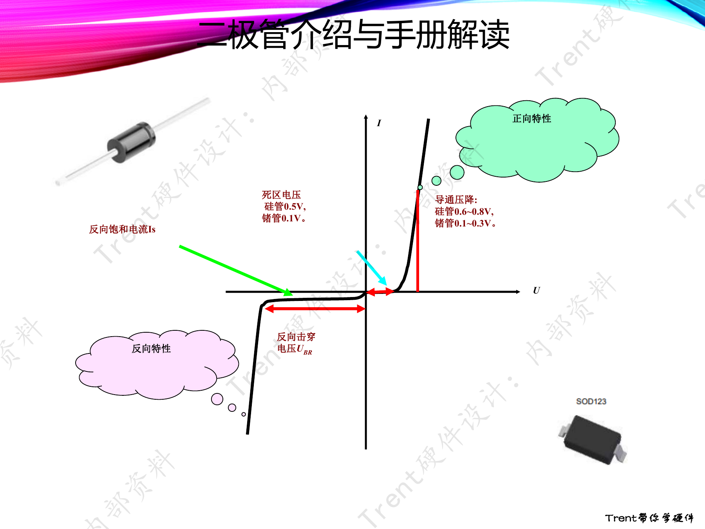
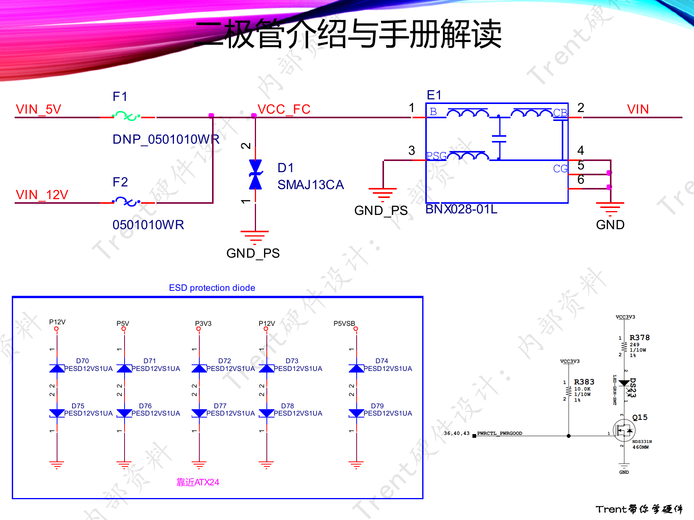
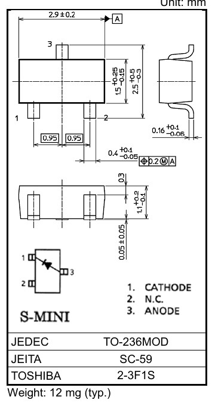
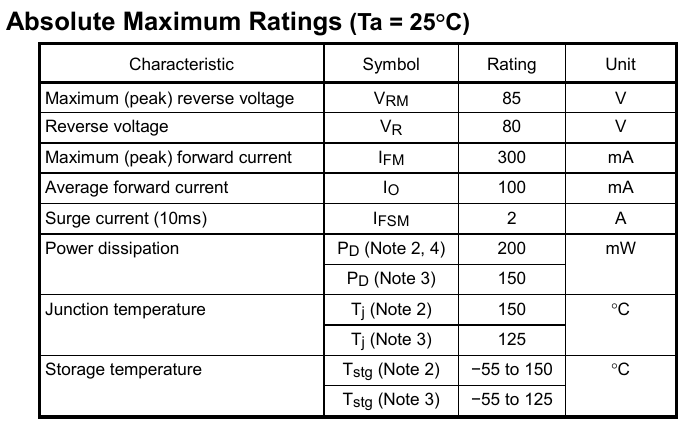
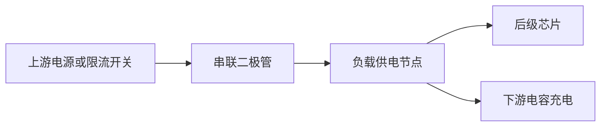
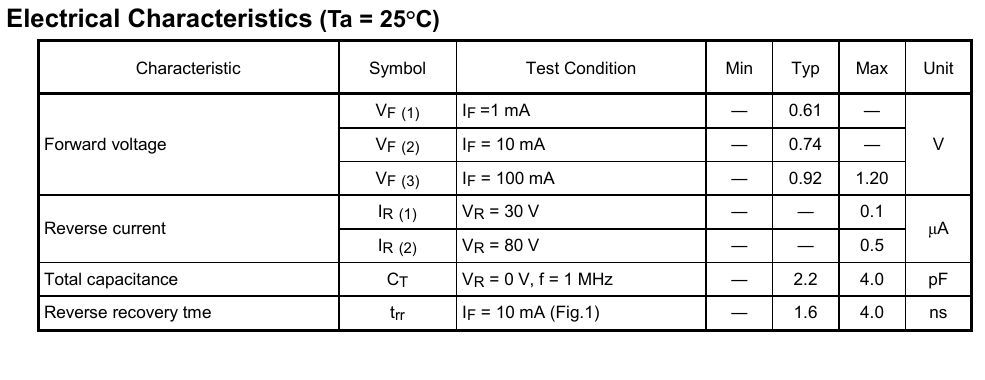
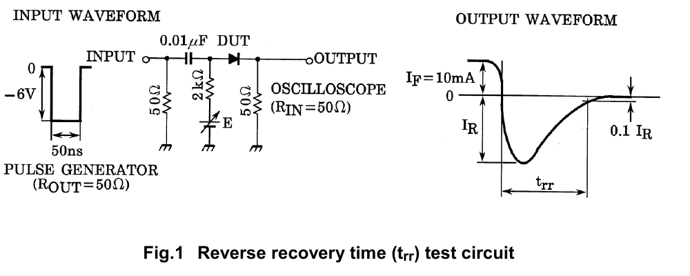
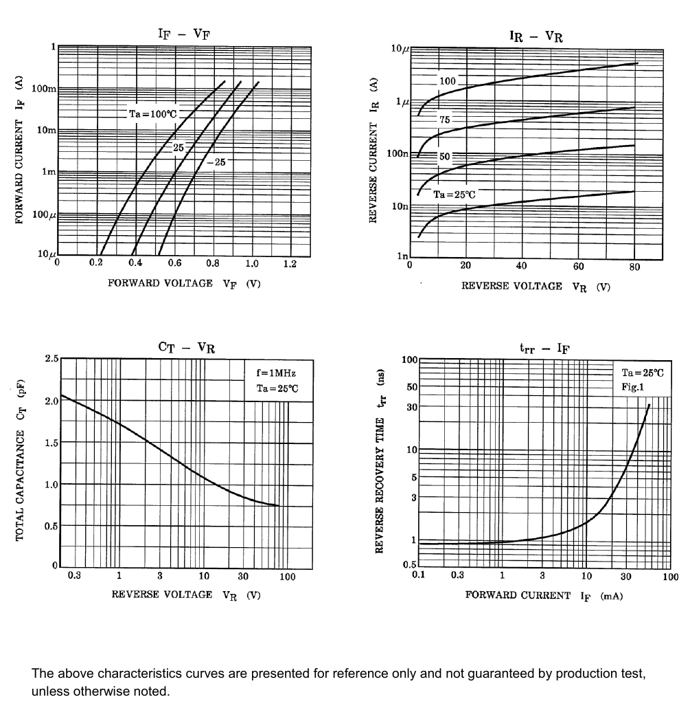
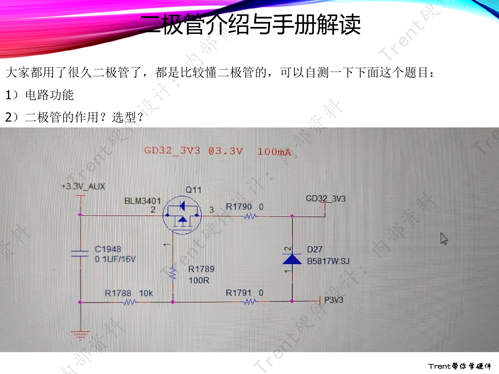

# 二极管介绍与手册解读

本篇只整理**二极管介绍与手册解读**，对应PPT第63–75页：伏安特性、1SS187手册、浪涌与启动、反向恢复及相关曲线。

稳压二极管已独立为[[B06-稳压二极管介绍与手册解读]]，对应第76–88页。两篇同属B06，但课程内容分别保存；未确认的后续课时不据此计为已学。此前尚无本节正式测验；2026-10-26已完成独立6题测验，详见本篇测验复盘。

## 看课对照表

| PDF页序 | 讲什么 | 笔记位置 |
|---|---|---|
| 63–64 | 入口、正向/反向伏安特性 | 第一部分 |
| 65–66 | 实际电路中二极管的不同用途 | 第二部分、案例分析 |
| 67 | 反向击穿概念 | 第一部分补充 |
| 68–69 | 类别检索、1SS187首页及封装 | 第三部分 |
| 70–71 | 最大额定值、反向电压、正向/浪涌电流、热限制 | 第四、五部分 |
| 72 | VF、IR、CT等电气特性表 | 第六部分 |
| 73 | 反向恢复时间和测试波形 | 第七部分 |
| 74 | 温度、电流、电压相关曲线 | 第八部分 |
| 75 | 本课结束页 | 不新增知识 |

## 第一部分：先看懂正向、反向和击穿（64、67页）

**看图重点：** 横轴是两端电压，纵轴是流过器件的电流。向右为正向区；反向偏置时仍有漏电；反向电压足够大时进入击穿区。这是概念示意，图中的固定压降数字不是所有型号的保证值。

### 1. 正向导通不是“电压刚好超过0.7 V才突然开关”

普通二极管的正向电流随正向电压连续变化。工程计算可用约0.7 V作某些硅管的粗估，但实际VF取决于**型号、正向电流和温度**。后面的1SS187手册就给出不同电流下不同的VF，不能只背一个常数。

常用符号：A为阳极（Anode），K为阴极（Cathode）。正向导通时，常规电流从A流向K；符号上的横线对应K。器件表面标识及PCB焊接方向要按具体手册确认，不能只凭颜色猜。

### 2. 反向不等于完全没有电流

在规定的反向电压下仍有IR漏电流。低功耗、纽扣电池供电尤其要留意其大小及温度条件，思路与之前电容漏电预算相通；**二极管IR与电容漏电是不同器件的参数，不能互换数值**。

### 3. 击穿电压、允许反向电压不要混用

允许的反向工作电压是使用约束；击穿电压是在规定反向电流下测得的器件特性，不应把器件故意运行在工作额定值以上。课件“超过额定反向电压就击穿”是简化说法：越过额定值意味着超出使用保证，具体击穿点由器件特性决定。

第67页提到齐纳和雪崩机理。这里只记录边界：**击穿不自动等于永久损坏**；专门设计用于受控击穿的器件仍需限制电流/功耗，普通二极管则不能未经规格支持就这样使用。详细稳压与TVS选型留待后续实际学习。

## 第二部分：先看接法，再判断用途（65–66页）

**看图重点：** 有的器件接在电源/地之间，有的出现在控制支路。它们都叫二极管，作用与工作状态却不一样。不能把所有二极管一律理解成串联整流管；图上也存在DNP选件，不能假设所有支路都同时装配导通。

本节先建立分析顺序：**找A/K和网名→看正常时正偏还是反偏→画需要导通时的电流路径→再查电压、电流和热条件。** 第66页出现的专用保护器件只作为位置识别，不据此认定已经学完后续TVS课程。

第65页的D27供电支路已单独归档到[[CASE-2026-10-25-10-GD32供电二极管D27读图|GD32供电二极管D27读图案例]]，附原图和适用边界。

## 第三部分：类别、首页与封装（68–69页）

第68页是器件检索分类的入口。整流、开关、稳压、肖特基、LED及瞬态保护器件的选型侧重点不同，**本节用开关二极管1SS187练习读手册**，不在这里抢先展开全部类别。

### 首页优点也有测试条件

课件第69页的“0.92 V、1.6 ns、2.2 pF”来自1SS187的典型特性，不能只抄首页数字就完成选型。应继续往电气特性表查对应电流、反向电压、频率及温度，并分清Typ与Max。

### 三个焊脚不等于三个功能端

**看图重点：** 这款1SS187有三个焊脚，但手册列出**1=K，2=N.C.，3=A**。N.C.是无连接端；不要因为三脚就当成三极管，也不要套用其他SOT-23器件的引脚。引脚图的视图方向和封装尺寸要一起核对。

## 第四部分：最大额定值是边界，不是推荐工作点（70–71页）

**看图重点：** 表头Ta=25 ℃；电流至少分平均、峰值和浪涌，不能互换。PD、Tj有脚注，不能在不同订货后缀之间任意选较大值。

| 东芝1SS187字段 | 本地手册表值 | 怎么用 |
|---|---:|---|
| VRM，最大峰值反向电压 | 85 V | 不是推荐长期反向工作电压，也不是直接给出的VBR |
| VR，反向电压 | 80 V | 与实际反向稳态/尖峰分别核对，并留合适裕量 |
| IFM，最大峰值正向电流 | 300 mA | 不能当成所有温度、任意波形下的连续电流 |
| IO，平均正向电流 | 100 mA | 同时满足热限制，不能只看平均值忽略峰值 |
| IFSM，浪涌电流 | 2 A，10 ms | 受持续时间和其他规定条件限制，不是长期2 A |
| PD，功耗 | 200或150 mW | 按订货后缀及安装条件选对应值 |
| Tj，结温 | 150或125 ℃ | 不是环境温度上限的同义词 |

**脚注必须保留：** 本地东芝2021版的Note 2适用于订货号以LF(T结尾的器件，Note 3适用于其他订货号；200 mW还关联Note 4给定的FR4板和焊盘条件。不能把200 mW、150 ℃随意套到所有1SS187。具体料号后缀不清时回到采购规格确认。

## 第五部分：本人重点疑问——浪涌电流与启动（71页）

### 1. 先分清三个对象

| 对象 | 要回答的问题 |
|---|---|
| 电路实际浪涌 | 开机/热插拔等过程中，实际流过多大电流、持续多久、什么波形、重复多频繁？ |
| 二极管IFSM | 在手册规定条件下，它能承受多大的短时正向电流？ |
| 上游供电能力 | 电源/限流开关能否支持这次启动而不严重掉压或进入保护？ |

**二极管是无源器件，通常没有“电源必须给够某个启动功率才能启动二极管”这一要求。** 更准确地说：电源限流或掉压，可能导致后级芯片/整条系统启动失败；如果实际浪涌超过二极管承受能力，则二极管可能受损。这是不同问题。

浪涌不限于“二极管内部产生”。例如下游未充电电容在上电时吸收充电电流，这部分电流经过串联二极管。实际大小由电源上升速度、限流、通路电阻、电容和负载共同决定，不能只由IFSM倒推出实际开机电流。

这是**AI补充的示意**：流过二极管的电流包含负载电流和充电电流；不是原课件的实测电路。

### 2. 把以前的电容知识接起来

$$i_C=C\frac{dv_C}{dt}.$$

**教学假设：** 100 µF电容两端电压在1 ms内上升5 V，期间的平均充电电流为：

$$I_{C,平均}=C\frac{\Delta V_C}{\Delta t}=100\times10^{-6}\frac{5}{10^{-3}}=0.5\ \mathrm{A}.$$

若负载同期平均需要50 mA，则忽略其他支路时二极管平均电流约为0.55 A。**这不是峰值计算**，也不是实板数据；若电压斜率不恒定，瞬时峰值可能不同。

随后需要分别核查电源的限流/启动过程、二极管的脉冲条件以及稳态电流。不能因“0.55 A小于2 A”就自动宣布合格，也不能用100 mA平均额定值直接否定所有短时脉冲：它们的适用时间与波形不同。

### 3. 同型号名也不能混用厂家条件

- **本地东芝2021版**：IFSM=2 A，标注10 ms。
- **本地长电2014版**：IFSM=2 A，标注8.3 ms、Non-Repetitive Peak。

两个数字一样，条件却不同。东芝本地这一页没有完整给出可直接用于任意应用的浪涌波形与重复规则，**不擅自补成8.3 ms半正弦、任意10 ms方波或可连续重复2 A**。需要具体波形和温度判据时查完整厂家规格、曲线或确认资料。

### 4. 进一步澄清：电源确实需要满足负载启动需求（2026-10-25）

**用户追问原话：**

> 启动浪涌不是电源要能够瞬间提供这个电流吗？否则有些器件会无法正常启动吧

**这项系统判断正确。** 如果启动时供电不足而限流、掉压或反复进入保护，后级器件确实可能无法正常启动。前面的纠正只针对“二极管本身有固定启动功率要求”这一措辞，**不能理解为否定上游的启动供电要求**。

把三者的责任放在一起：

| 对象 | 需要满足的要求 |
|---|---|
| 上游电源及供电网络 | 在启动过程中提供所需电流，使负载电压按规定范围和时序上升 |
| 串联二极管 | 承受实际流过的启动电流，不超过对应波形、时间、温度下的电流及热限制 |
| 后级负载 | 获得符合其上电要求的电压、电流和时序，不能用稳态电流代替全部启动需求 |

**“支持启动”不一定等于原样提供不加限制时的浪涌峰值。** 应区分：

- **负载真正需要的启动电流**：若不给足、造成电压不满足要求，就可能启动失败，不能随意削减。
- **电容快速充电造成的电流**：可通过软启动、控制电压上升速度等方式降低，前提是改变后的上电过程仍满足负载要求。

对于同一供电节点、忽略其他支路时，可用下式建立直观关系：

$$i_{上游}\approx i_{负载}+C\frac{dv}{dt}.$$

**假设算例（非实测）：** 某启动阶段负载需要0.5 A，电容充电电流为1 A，则该阶段总需求约1.5 A；若通过控制上升斜率，将充电电流降到0.2 A，且负载仍允许这样上电，则总需求可降到约0.7 A。这里不是说所有启动浪涌都能按相同比例降低，也不把某段需求当整个启动过程的固定值。

极短瞬态还可能由附近储能电容分担，不要求上游DC-DC在每一瞬间独自提供全部峰值；但**整个供电网络仍必须保证负载端电压和时序满足要求**。这与前面去耦电容提供局部变化电流的知识相衔接。

**工程结论：电源必须支持设计好的启动过程；二极管必须承受实际脉冲。可以管理充电浪涌，但不能忽略负载真实启动需求。**

AI补充依据：[TI：控制负载开关输出电压上升速度以减小充电浪涌](https://www.ti.com/document-viewer/lit/html/SSZTBX2/GUID-2AF5E1CE-C09D-447F-ACB7-ED209C847E47)。这段是对已有课堂笔记的进一步解释，用户的正确判断予以保留；尚无独立算例作答，不预填掌握分数。

## 第六部分：电气特性要把“值和条件”一起读（72页）

**看图重点：** 从左到右读参数、条件、Min/Typ/Max和单位。同一VF，在不同IF下有不同值；反向漏电同样要带VR条件。

| 参数 | 东芝本地手册实例（Ta=25 ℃） | 含义 |
|---|---|---|
| VF | IF=1 mA时典型0.61 V；10 mA时0.74 V；100 mA时典型0.92 V、最大1.20 V | “硅管恒定0.7 V”只能是简化估算 |
| IR | VR=30 V时最大0.1 µA；80 V时最大0.5 µA | 这些不是任意反向电压、任意温度下的固定漏电 |
| CT | VR=0、f=1 MHz时典型2.2 pF、最大4.0 pF | 结/端口电容影响高频线路，条件改变会变化 |
| trr | IF=10 mA、按Fig.1测试时典型1.6 ns、最大4.0 ns | 是给定测试条件下的开关恢复参数 |

反向漏电与开关反向恢复电流不是同一种现象；看到反向电流脉冲，不能立即断言二极管击穿或漏电超标。

## 第七部分：反向恢复时间怎么理解（73页）

**看图重点：** 正向电流降到零后，仍出现一段反向电流，再恢复阻断能力；图中的结束判据标为反向峰值的0.1倍，而不是数学意义上的绝对零电流。表中trr要与这张测试图一起读。

本节PN结开关二极管由正向导通切换到反偏时，需要处理存储电荷，所以不是瞬间理想关断。频率较高的切换电路需要关注恢复时间、反向电流及相关损耗；**不能把一次启动浪涌和每次切换的反向恢复混为一件事**。不同二极管技术的差异留到对应课程再细讲。

## 第八部分：读曲线，而不是只背表值（74页）

**按四个角读图：**

1. **左上IF–VF**：固定电流看不同温度对应VF；本图所示正常正向区中，较高温度下同电流所需VF较低。它不是所有器件、所有电流区的无限外推公式。
2. **右上IR–VR**：比较温度曲线，漏电可能随温度显著增加，室温值不能直接用于高温预算。
3. **左下CT–VR**：本图电容随反向电压变化，不是固定2.2 pF到处适用。
4. **右下trr–IF**：恢复时间受测试电流影响，不能脱离条件只看首页“1.6 ns”。

**曲线下方原注：** 这些特性曲线通常是参考值，除非另有说明，不由生产测试逐点保证。做最坏情况校验时优先找有保证的Max/Min和条件，不把典型曲线当全部样品上限。

## 课堂电路案例入口

本次仅沿二极管识别电流方向与正向压降，详细见[[CASE-2026-10-25-10-GD32供电二极管D27读图]]。Q11及完整电源切换时序不在本节展开，也不把仅凭截图的分析当实际板卡验证。

## 选型时按这个顺序检查

1. 先确定用途和所需工作状态，不把开关二极管与专用稳压/保护器件直接替换。
2. 核对完整厂家料号、版本、封装、A/K/NC及焊盘。
3. 查实际反向电压及瞬态、正向平均/峰值电流、启动浪涌波形与时间。
4. 按实际IF和温度找VF，核算负载端电压与器件损耗。
5. 检查温度、允许功耗、结温及PCB散热条件；高频场合再重点查trr、CT和IR。
6. 结合上游限流/启动过程验证；资料不完整时记录缺口，不用一个IFSM数字代替整条供电链路检查。

## 本人原笔记与澄清

**本人原话：**

> 浪涌电流 surge current 比如一个二极管在开机的瞬间电路内部会有一个浪涌电流 如果电源无法给到这个功率可能二极管就无法启动

**保留原意后的表述：** 开机时，电容充电等过程可能产生经过二极管的浪涌电流。既要确认上游电源能否支持启动、避免限流掉压，也要确认二极管能否承受实际脉冲；不能称作二极管有固定的启动功率要求。

这属于课堂笔记的概念澄清，**没有伪造成一次测验错题**。之后若独立回答，再记录实际证据与掌握度。

## 学习状态与待验证

- 本篇记录介绍与手册63–75页；稳压管76–88页见独立笔记。B06整体仍学习中；2026-10-26介绍/手册6题专项已完成，实际掌握与待复测见下方，不计后续课时。
- 待验证：IFM/IO/IFSM区别、浪涌与电源启动、VF的电流温度条件、反向额定/漏电、trr判据与引脚识读。
- 之前已学电容充电及电阻功率思路可帮助理解，但不能据此预填本节正确答案。

## 来源与阅读边界

- SRC-04d3eaeffca5：[基础篇-03.pdf](D:/课程原始资料/硬件基础篇课程资料/01基础知识培训部分/PPT/基础篇-03.pdf)，本次正文第63–75页；64–74页逐页图表核对。只为划分范围检索后续标题，未将76–117页计入本次已学。
- SRC-d562d8787dec：[东芝1SS187，2021-06-25本地版](D:/课程原始资料/硬件基础篇课程资料/01基础知识培训部分/硬件设计基础课时器件手册/05二极管手册/1SS187_datasheet_en_20210625%20(1).pdf)，全文提取，重点目视核对第1–3页；图片均保留其版本身份。[东芝官网文档](https://toshiba.semicon-storage.com/info/docget.jsp?did=3268&prodName=1SS187)于2026-10-25核对，页面显示2026-04-07版，所核对主要额定值一致，不据此覆盖本地原件。
- SRC-3714f6b28713：[长电1SS187，2014版](D:/课程原始资料/硬件基础篇课程资料/01基础知识培训部分/硬件设计基础课时器件手册/05二极管手册/贴片开关二极管-1SS187-SOT-23-规格书推荐.pdf)，重点第1页额定/条件及第2页降额图。不同厂家参数分开使用。
- 课件D27是B5817W标记；本地B5817WS–B5819WS资料仅用作型号族背景核查，不能从相似名称断定其厂家、封装及电流额定完全一致。实际BOM仍待确认。

## 2026-10-26介绍与手册测验复盘

6题已完成：第3题首次数值90及不满足判断正确，但单位写mv（应mW）；第1题首次否定判断正确而原因不知道，提示后按100 mA查VF正确；第2题长期电流/发热判断正确，重复脉冲原因不知道；第4题首次不会，解释后按小漏电选择A正确；第5题载流子/换向描述及否定1/trr方向正确，恢复终点由助手补充；第6题首次不知道。无完整首次独立正确题，不否定各题已正确的部分，不将教学及提示后答案当独立掌握。

| 题目 | 实际表现与后续 |
|---|---|
| VF条件 | 首次不同意但不知道原因，解释后能按100 mA查VF |
| 电流/浪涌 | 长期1 A及发热理由正确；重复脉冲原因不知道，已教学 |
| 功耗 | 首次90与不满足判断正确，单位mv应改mW，保留原文 |
| IR/CT | 首次不知道；解释后按小漏电选A正确，定义与条件仍待复测 |
| trr | 载流子、换向及否定1/trr方向正确；反向电流衰减终点由助手补充 |
| 启动协调 | 首次不知道；电源供应与器件承受是两项独立要求，已教学 |

**工程补充——启动协调：** 不能认定启动供电满足要求。电源及供电网络需在启动过程中提供负载和电容充电等所需电流，使电压及上电时序满足负载要求；二极管IFSM仅说明规定脉冲和温度条件下的承受能力，不证明上游供电充足。二极管能承受、电源能供应是两项分别核查的条件。题目已出现限流掉压及反复重启，需检查实际需求、限流/启动方式及供电路径。

**重复浪涌：** 短间隔反复脉冲可能使结温累积升高；单次IFSM不保证重复工作通过。按实际波形、持续时间、重复频率、峰值/平均电流及散热条件检查。

**功耗单位：** P=VF×IF，V×A=W；本题0.9×0.1=0.09 W=90 mW，mV是电压单位。

**反向恢复：** 电流过零、变为反向尚非终点，须看手册反向恢复电流衰减判据；无需深入微观物理推导。

完整记录[[SESSION-2026-10-26-02-二极管介绍与手册解读测验]]。次日2026-10-27按五项实际薄弱主题主动回忆，不提前展示答案；其余未考条件不推定掌握。原始课堂记录与图片保留。

## 我的补充（保留后续个人记录）

后续在此追加课堂疑问与实测；正文中的教学数值、课程截图和AI解释不等于本人实测或已掌握。
