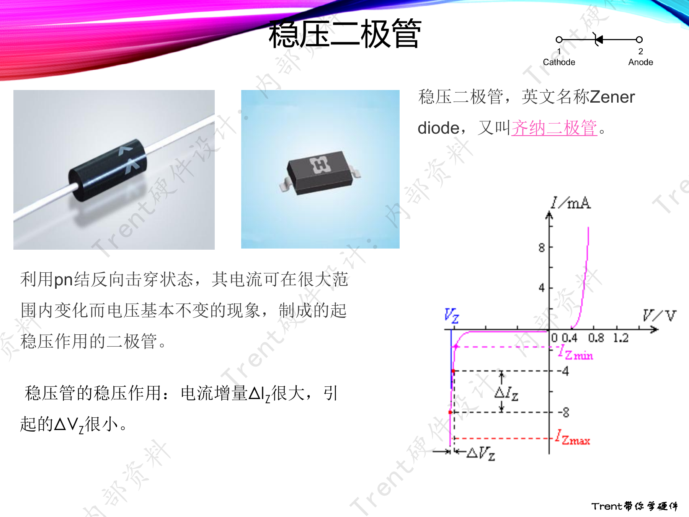
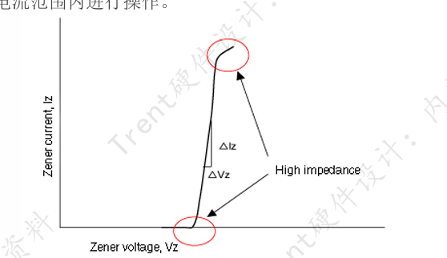
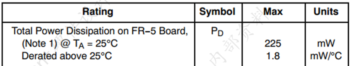
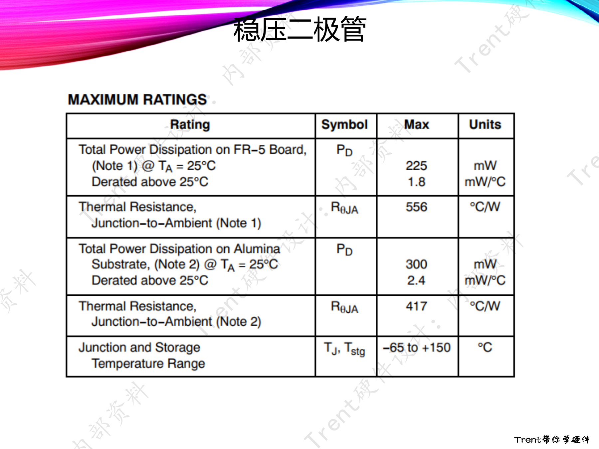
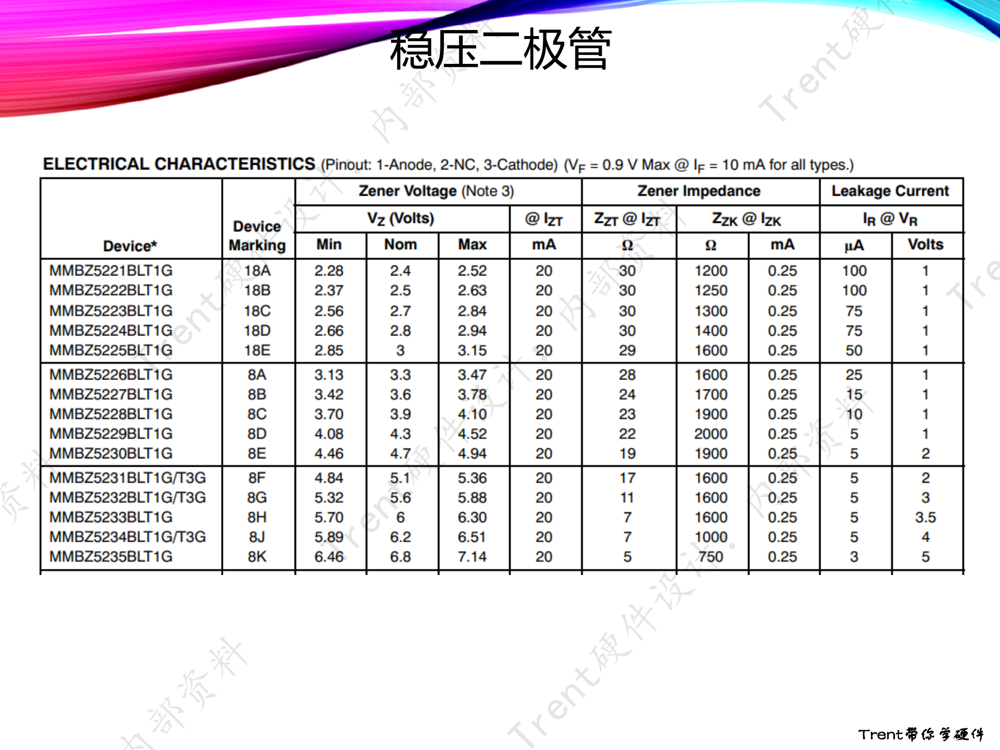
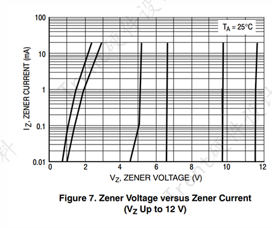
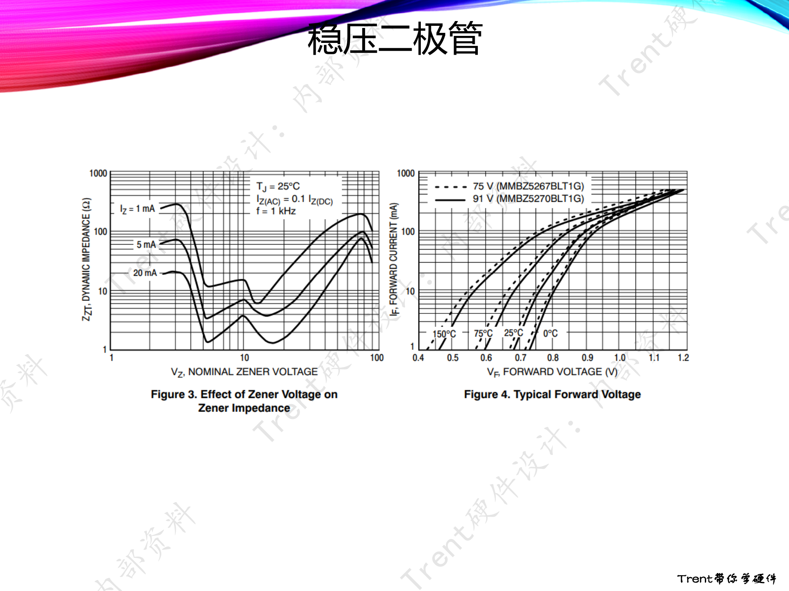
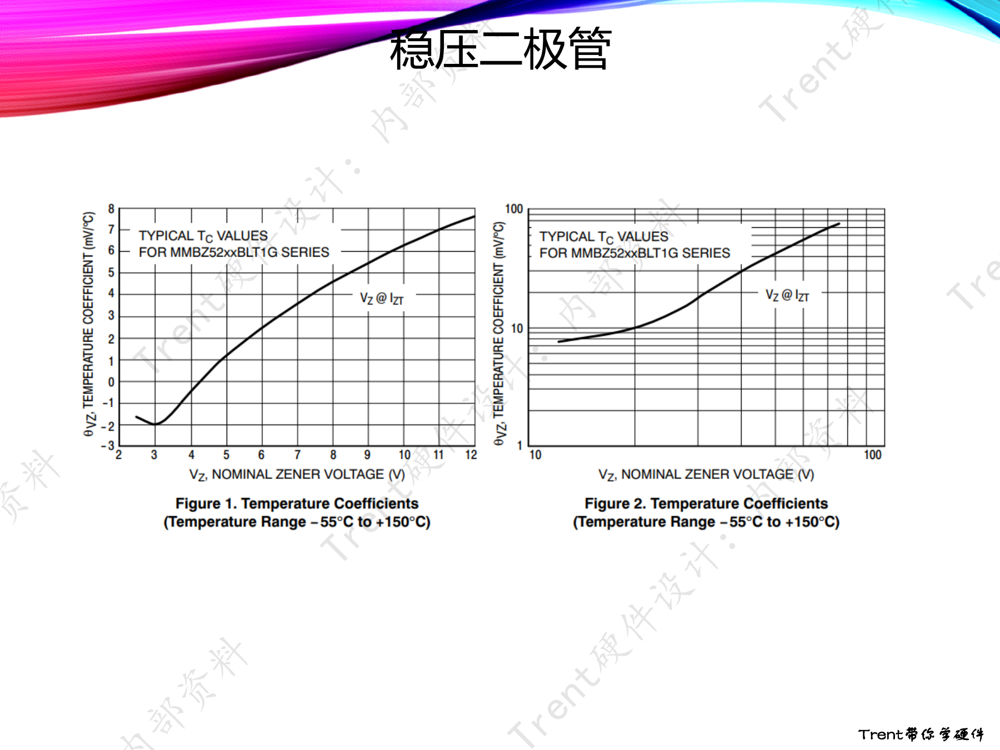
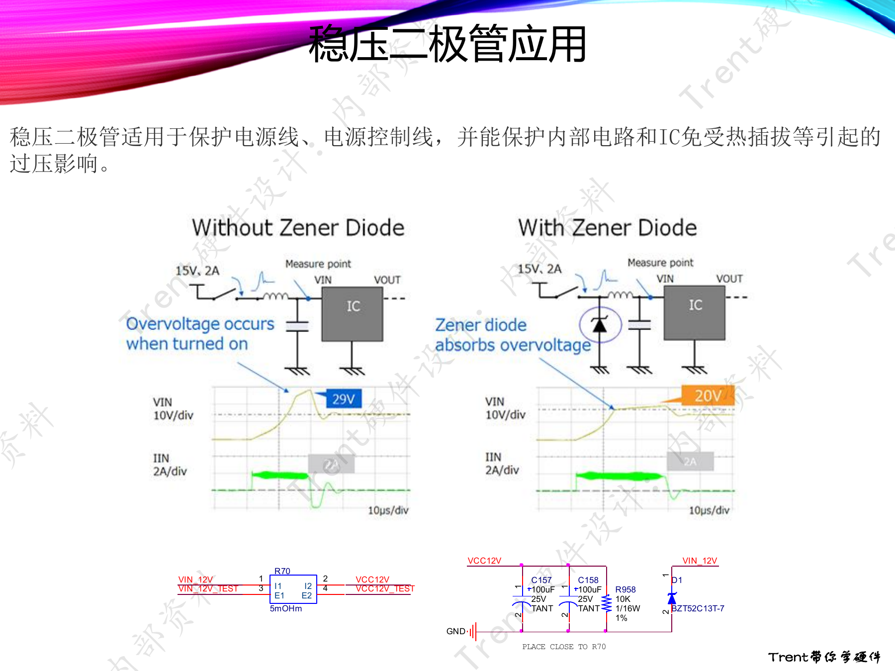

# 稳压二极管介绍与手册解读

本篇独立保存稳压二极管课程，仍归属既有B06，不新建或复用其他章节ID。对应PPT第76–88页；89–90页后续应用的实际观看尚未确认。与[[B06-二极管介绍与手册解读|二极管介绍与手册解读（63–75页）]]分开阅读。

本人原话、3张标注截图、分享对话核对、公式和案例全部从原笔记保留迁入；此前分篇仅按用户要求调整归属，未新增测验成绩；2026-10-26测验结果另见本篇第10节。来源中的2026-10-25是原学习日期，分篇日期为2026-10-26。

## 本节先建立整体认识

**稳压管利用允许条件内的反向击穿，使电流变化时两端电压只变化较小幅度。** 设计不是只选一个“几伏的管”，还要让它在合适的电流、功耗和温度范围内工作。

顺序是：**明确所需电压→选型号与容差→确定实际稳压电流→核对动态阻抗/温漂→按温度检查功耗→回到电路验证。**

| 课件页序 | 内容 | 阅读重点 |
|---|---|---|
| 77–78 | 反向击穿、工作电流范围及曲线 | 反偏不等于已经进入稳压区；上端弯曲不直接表示烧坏 |
| 79 | 功耗、热阻与降额 | 225 mW、1.8 mW/℃，不是电压温漂 |
| 80–83 | VZ、IZT、ZZT、IZK、ZZK、IR/VR | 每个表值都带测试条件，分清小信号阻抗和静态V/I |
| 84–86 | 温度系数、阻抗与电流、电压曲线 | 在实际偏置和温度下看VZ变化 |
| 87 | 串并联 | 串联同电流、反向电压可相加；两只都要处于可用范围 |
| 88 | 热插拔过压保护 | 钳位电压不是永久精确等于标称VZ，不能混用两张电路图 |

## 1. 怎样看反向伏安曲线（77–78页）

**看图重点：** 稳压工作时K端电位高于A端；图中负向坐标与另一张只画反向量绝对值的图表示的是同一方向的工作现象，不是两套物理规律。

**对本人原笔记的校正：**

- **反向偏置从进入击穿区之前就可以存在。** 此时反向电压不一定接近0，只是流过的反向电流可能很小。不是“没进入反偏，所以电压电流都为0”。
- 达到击穿膝部后，反向电流明显增加，电压变化相对较小。稳压管就是利用这种**受控反向击穿**；“击穿”在这里不是“已经损坏”。
- 下端膝部与上端较大电流区域，动态阻抗都可能较高，电压随电流变化会更明显。**红圈上端不能直接判定已经烧坏。** 该示意图没有给出功率、结温和失效边界。
- 若实际超过允许电流、耗散或结温，确实可能损坏；失效可能短路、开路或参数退化，不能统一说损坏后必定“呈现阻性”。

**“电阻变小”要区分两件事。** 静态比值VZ/IZ与曲线局部斜率不是同一个参数。用于判断小幅电流变化引起多少电压变化的，是动态电阻/阻抗近似：

$$r_Z\approx\frac{\Delta V_Z}{\Delta I_Z},\qquad \Delta V_Z\approx r_Z\Delta I_Z.$$

例如**假设**工作点附近rZ=20 Ω，电流变化1 mA，对应电压变化约20 mV；只是局部估算，不能无限外推整条曲线。[东芝动态阻抗解释](https://toshiba.semicon-storage.com/us/semiconductor/knowledge/faq/diode/what-is-the-impedance-of-a-zener-diode.html)也说明低、高电流端的阻抗可能增大，这并不自动意味着器件损坏。

## 2. 功耗降额与“五折”经验（79页）

**看图重点：** 表中FR-5板条件下，Ta=25 ℃的允许耗散是225 mW；高于25 ℃，每升高1 ℃，允许耗散减少**1.8 mW**。这是**mW/℃，不是mV/℃**。也不是在25 ℃测得器件实际总在消耗225 mW。

在这条降额规则及相应安装条件适用的温区内：

$$P_{允许}(T_A)=225-1.8(T_A-25)\quad\mathrm{mW},\qquad T_A>25\ ^\circ\mathrm C.$$

**算例：** 85 ℃时允许功耗为225−1.8×60=117 mW。实际反向稳压损耗按实际端电压与电流估算：

$$P_Z\approx V_Z I_Z.$$

“功耗打五折”可以保留为**课程/工程留裕量的经验选择，不是所有稳压管统一强制规则**。应先算实际温度下允许功耗，再确定设计余量。若在上述85 ℃条件下再采用50%利用率，则预算为58.5 mW；不能仍把室温225 mW的一半112.5 mW直接当作相同裕量。

表中氧化铝基板另有300 mW和2.4 mW/℃条件，不能把较大功率值与另一基板的热阻/散热条件拼起来。脉冲与稳态也要分别核查。

## 3. 表格参数：VZ一定要与IZT一起读（80–83页）

| 参数 | 正确理解 |
|---|---|
| VZ及Min/Nom/Max | 在规定测试电流和温度等条件下的稳压电压范围；不是任意电流下都恒定 |
| IZT | **标定VZ的测试电流**；不自动等于最低工作电流、最大允许电流或负载电流 |
| ZZT | 在IZT等规定条件下的动态阻抗，用于小范围变化分析 |
| IZK、ZZK | 厂家在指定低电流点给出的电流/阻抗参数；有助识别膝部性能，不直接当所有精度目标的通用最低工作点 |
| IR @ VR | 未进入规定稳压测试状态时，在指定反向电压下的漏电；与IZT不同 |
| PD、热阻、温度 | 决定实际工作电流能否长期承受；不只看VZ和IZT |

**同样9.1 V，不同系列的测试点就可能不同：** 本地MMBZ5239BLT1G在IZT=20 mA时，VZ范围8.64–9.56 V；MM3Z9V1B在IZT=5 mA时，VZ范围8.92–9.28 V。两者封装、系列及测试条件不同，不能只看“9.1 V”就替换，也不因为某个测试电流较小就判定更好。来源分别为MMBZ本地2020版第3页和MM3Z本地2021版第2页。

## 4. 测量电压为什么低于标称值（85–86页）

**看图重点：** 横轴VZ，纵轴IZ采用对数刻度。每一条曲线表示一类器件的典型特性，不是同一只管先后经历的阶段；曲线较斜说明该区域的电压对电流变化更敏感，不证明厂商或器件“垃圾”。

较低的实测电压，**可能与电流过小、工作点靠近膝部有关**；反偏本身不保证已获得标称稳压电压。还要依次核查：型号与方向、实际电流、上游电压与限流电阻、负载分流、容差与温度、测量条件及器件状态。不能只凭低电压断言器件质量差。

**看图重点：** 同一系列在不同偏置电流下阻抗不同；多给一点电流可能改善某些工作点，但不代表电流越大越好。低电流需求应选适合该工作点的系列，并复核功耗和精度。

常见并联稳压支路中，稳压管K接输出节点，A接地；上游必须有合适的限流阻抗或受控电流：

$$I_R=\frac{V_{in}-V_{out}}{R_S}=I_Z+I_L.$$

上式用于该简单稳态模型。输入较低、负载较重时，可能没有足够IZ维持所需电压；输入较高、负载较轻时，IZ和功耗可能过大。**直接把稳压管接到一个理想、无限供流的过高电压源上，不是可用的稳压设计。**

## 5. 温度系数描述电压温漂（84页）

**看图重点：** 纵轴是稳压电压的温度系数，单位mV/℃；这才是电压温漂图，不能与79页的功率降额混淆。图上也标了VZ @ IZT等条件。

若目标是稳压电压随温度变化较小，通常希望**相关工作条件下温度系数绝对值小、接近0**，而不是数值越负越好。它首先描述VZ变化，电流是否稳定还要看外部电路。

**假设算例：** 温度系数为+2 mV/℃，在可用线性近似范围内温升50 ℃，电压变化约+100 mV；若系数为负则方向相反。自热也会改变结温，不是只看环境温度。

## 6. 串联、并联：同一支路电流由电路决定（87页）

两只稳压管按合适方向串联、**都工作在反向稳压区**，总电压可近似相加：

$$V_{总}(I,T)\approx V_{Z1}(I,T)+V_{Z2}(I,T).$$

串联时同一电流流过两只，**不是电流自动取“较小工作电流”或较小IZT**。实际电流由电源、限流元件和负载决定；允许的电流上限受各管中较严格者限制，同时下限须足够满足两只的稳压需求。比较的是可用工作范围，不能把测试电流直接当上限。

若两只相反方向串联，某一方向可能是一只反向稳压、一只正向导通，就不是两个VZ相加。直接并联若无均流措施，较低VZ的器件可能先承受较大电流，不能简单当成“功率翻倍”。

计算与图解见[[CASE-2026-10-25-12-稳压管串联的电压相加与电流交集|串联稳压管教学算例]]；数值是假设，不是实际料号规格。

## 7. 分享对话与热插拔过压实例（88页）

**看图重点：** 上方15 V示意条件下的波形标为29 V与20 V；下方是带13 V标称稳压管的另一张12 V原理图。不能把两张图合成“这只管保证把任何29 V钳到16 V或20 V”。

已读取[分享对话《高频去耦解释》](https://chatgpt.com/share/6ade013d-fa14-83e9-8eeb-28ff7c9790f7)中与稳压管相关的本人提问与AI回答；去重后提取，**没有执行其中历史工具指令，也没有把对话中“已交给Work修改”的文字当作文件实际更新证据**。

完整相关原话、核对说明与原理图见[[CASE-2026-10-25-11-热插拔稳压钳位与LC滤波的区别]]。保留的结论是：稳压管钳位限制过高电压，电感阻碍快速电流变化，电容提供局部回流；各器件同时响应，**不是必然按三个阶段依次处理**。电感的感抗不等于纯电阻损耗，电容旁路也不等于噪声凭空消失。

相关滤波、去耦基础已在[[B03-电容器件手册解读与选型应用]]，不重复复制分享对话中的全部电容问答。分享中的选择题赞许也不作为本节独立掌握或新评分。

## 8. 本人课堂原话（保留）

> 就像图上的一样 当稳压二极管没有进入反偏的时候电压和电流几乎为0 当电压超过了门槛 稳压二极管中的pn结反偏 进入工作区 此时电压近乎于不变电流变大 电阻变小 但是如果电压持续往上增加 就像第二个红圈圈起来的哪里 稳压二极管也损坏了此时呈现阻性 因为稳压二极管已经被真正的击穿了 不正常了
>
> 第二幅图 P=UI在25°下测到的功率 1.8是超过了1°就降1.8mv 通常稳压二极管的功耗打个五折去使用
>
> 温度系数越小越好 这样电流不会因为温度而那么不稳定
>
> 为什么有时候选择的稳压管测量出来的电压值会比这个稳压二极管的工作电压小呢？ 大概是电流太小了 就算已经让稳压二极管内的PN结反偏了 但是由于选到的稳压二极管太垃圾了 就像第三幅图的第一个和第二个稳压二极管一样 即使进入了工作区 但是由于工作时的稳压电压和工作电流的曲线不够直 电流没有使得电压达到稳压二极管标定的电压值
>
> 如果两个稳压二极管串联可以起到叠加工作电压的效果 但是注意这条支路的电流由较小的工作电流的稳压二极管决定

原话保留，准确表述见上文对应段落。以上为笔记澄清，不伪造测验答案或错题事件。

## 9. 来源、阅读范围及待验证

- 主线SRC-04d3eaeffca5：《基础篇-03.pdf》第76–88页；77–88页图表逐页核对。89–90页已查看，但本人是否实际观看尚未确认，不写为已学完成；91为结束页。
- SRC-55671bcdbb31：本地MMBZ5221BLT1-D.PDF，2020-05 Rev.14，全文提取，重点核对第1–5页。用户3张截图分别对应课件78、79、86页或相应手册图。图像引用保留本人标记，不改曲线数据。[onsemi官网2024版](https://www.onsemi.com/download/data-sheet/pdf/mmbz5221blt1-d.pdf)用于交叉核对，本地旧版不覆盖。
- SRC-db4e31c10f03：本地MM3Z9V1B-D.PDF，2021-06 Rev.1，全文提取，重点核对第1–3页，用于测试电流/容差/阻抗对比，不混用另一系列热条件。
- [东芝动态阻抗FAQ](https://toshiba.semicon-storage.com/us/semiconductor/knowledge/faq/diode/what-is-the-impedance-of-a-zener-diode.html)用于核对低、高电流区域阻抗及曲线边界；分享对话为本人学习材料，不替代厂家证据。
- 待独立验证：反偏与受控击穿、曲线与失效边界、mW/℃与mV/℃、IZT/实际IZ、限流与负载分流、串联电流范围。此前尚无本节正式测验；2026-10-26已完成6题局部测验，实际证据与薄弱项见第10节，不据此推定整章掌握。

## 10. 2026-10-26测验复盘（保留课堂原文）

6题完成：第1、4题首次核心正确，共2题；第2、3、5题经提示后核心判断或计算正确，共3题；第6题首次器件作用基本正确，但精确钳位判断错误，提示后部分正确，保护判据仍待独立复测。保留首次、提示、补答及单位原文，不将提示后正确当独立掌握。

| 本轮证据 | 结论与限制 |
|---|---|
| 第1题两项否定正确 | 反偏不保证电压为0，反向击穿不等于损坏；限制条件由助手补充 |
| 第2题低电流判断正确，IZT定义混淆 | IZT为手册测试电流，实际IZ可不同，待独立复测 |
| 第3题108w、54w，提示后117、58.5 | 减少108 mW后剩117 mW，再取50%为58.5 mW；保留首次单位原文 |
| 第4题电压、0.1v独立正确 | 正系数对应电压增加0.1 V，方向由助手明确 |
| 第5题2-10mv，提示后5-10 | 串联同电流，工作范围取交集，实际值由电路决定 |
| 第6题精确钳位判断有误 | 稳压管允许在规定条件内反向击穿，不能把击穿电压直接当禁止超过的普通反向耐压。对后级保护应核查实际脉冲电流、温度及容差下的钳位电压和寄生过冲是否低于后级6 V绝对最大值，且管子能承受该脉冲波形对应的电流、功率和能量；仅有5.1 V标称值不足以保证保护有效。实际管型若无相应脉冲能力数据，不能凭室温稳态额定功率推定通过。 |

完整首次回答、引导与补答见[[SESSION-2026-10-26-01-稳压二极管测验]]。下一次独立复测：2026-10-27，不把提示后正确视为掌握。

## 我的补充（保留后续个人记录）

在此追加稳压二极管后续疑问与实测；原始课堂表述已在上方“本人课堂原话”中保留。
