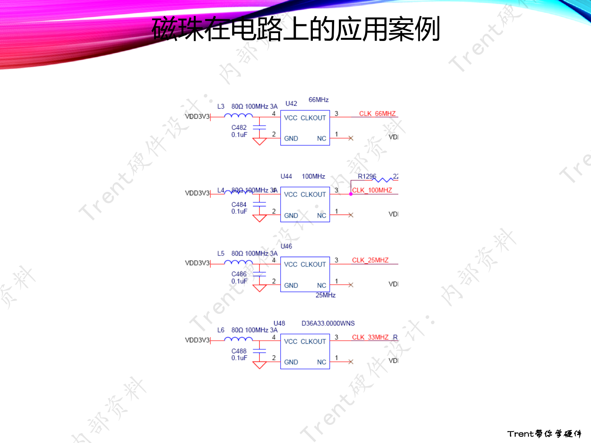

# 有源晶振电源磁珠隔离

**来源：**《基础篇-03.pdf》第60页；《电感、磁珠基础及在公司实际工作中的应用》2.5(a)，PDF第11页。课程案例，非用户实测。

## 先沿图看清器件和路径

| 有源晶振 | 时钟输出 | 电源支路磁珠 | 负载侧电容 |
|---|---|---|---|
| U42 | 66 MHz | L3 | C482，0.1 µF |
| U44 | 100 MHz | L4 | C484，0.1 µF |
| U46 | 25 MHz | L5 | C486，0.1 µF |
| U48 | 33 MHz | L6 | C488，0.1 µF |

图中磁珠标注为**80 Ω @100 MHz、3 A**。这是阻抗/频率/额定电流标记；不是80 Ω的直流电阻，也不表示每只晶振消耗3 A。仅凭标记还不能验证实际料号的全频带效果。

供电路径：系统VDD3V3经过对应磁珠，到有源晶振的VCC（4脚）；去耦电容位于磁珠之后，对地连接，晶振GND为2脚；CLKOUT在3脚。**磁珠串在电源，不在时钟输出上。**

## 为什么这样放？

课程意图是防止晶振电路的高频扰动经VCC进入共享3.3 V电源；这个网络也会影响外部电源噪声进入晶振。实际隔离量取决于两侧阻抗及布局，不是理想单向阀。

1. 正常直流供电要通过磁珠，因此先核对晶振实际电流与DCR压降。
2. 晶振内部振荡/缓冲输出会产生变化的供电电流；高频成分可能经电源、地和寄生耦合传播。
3. 负载侧电容为变化电流提供局部回路，磁珠在目标频带增加与公共电源之间的阻抗，并通过损耗耗散部分能量。
4. PCB上电容到VCC及地的回路要短；供电端隔离不能替代时钟输出端的信号完整性设计。

**不要混淆“信号频率”：** 本图电源路径希望保留的是直流；66/100/25/33 MHz是CLKOUT输出频率，并不是VCC线上必须无衰减传输的有效供电信号。评估供电噪声要结合实际谱及谐波，不能只把时钟基频与R/X交点比较。

## 工程核查清单与结论

核对额定/启动电流、DCR与VCC下限；查带直流偏置的Z/R/X与目标噪声频带；看电容有效容量与回路；比较加磁珠前后电源噪声、时钟波形和启动行为。原图没有给完整测量结果，**不编造改善多少dB或抖动减少多少**。

带走的结论：**有源晶振的电源磁珠用于供电支路高频隔离，必须与本地去耦及供电压降预算一起判断。**

返回[[B05-磁珠介绍与手册解读]]。
