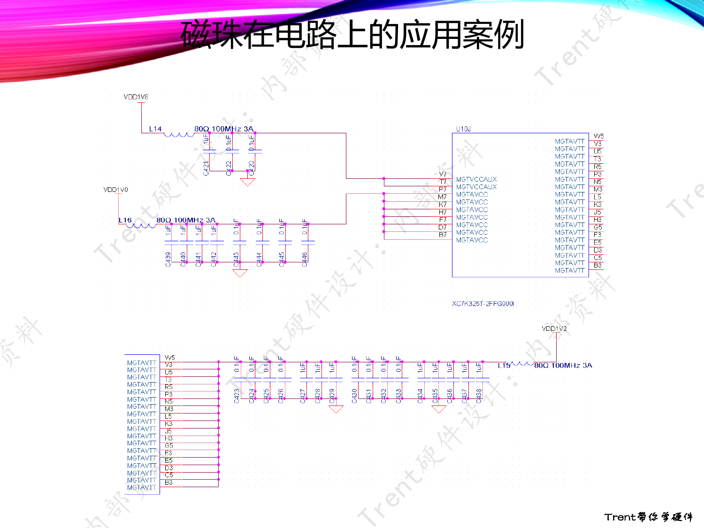

# FPGA低温供电压降与磁珠排查

**来源：**《基础篇-03.pdf》第61页；《电感、磁珠基础及在公司实际工作中的应用》2.5(b)，PDF第11–12页。下述过程是**文档作者的项目叙述**，不是用户测量记录，也不是独立复现实验。

## 原案例发生了什么？

文档描述A701项目在**−55 ℃**下，使用FPGA高速接口的SRIO、光纤接口开机首轮测试报错。排查发现供电已偏低，经过磁珠后电压进一步降低，负载端接近正常工作范围下限。作者还指出PCB通流能力及低温工作边界的影响。

处理经过：

1. 将相关的两个磁珠短接，情况明显好转，但作者仍报告约10%的出错几率。
2. 再调整电源芯片分压电阻，略提高1.0 V、1.8 V输出，文档报告问题解决。

原文没有提供完整波形、误差预算、统计样本量和前后参数，所以“问题解决”仅按案例作者报告保存，不升级为本人的已验证结论。

## 沿图读网名，注意原资料差异

图中有三路：VDD1V8经L14到MGT VCCAUX，VDD1V0经L16到MGTAVCC，VDD1V2经L15到MGTAVTT；磁珠标注80 Ω @100 MHz、3 A。文字叙述概括了MGTAVCC/MGTAVTT及L15/L16，但又提调整1.0/1.8 V，**与图中各路的描述不完全一致**。可能涉及不同版本或叙述简化，原资料不足以确定；不能擅自断定究竟是哪两路的实测电压不足。实际定位必须回到原板版本、BOM及测点。

## 工程上应该怎样理解？

关键是**电压预算和实际负载条件**，而不是一句“低温时磁珠通流能力变小”：

$$V_{负载}\approx V_{电源端}-I_{\mathrm{DC}}(R_{磁珠}+R_{走线}+R_{连接}).$$

这是稳态压降的简化预算；启动和快速负载变化还要另外看瞬态、局部去耦与回流寄生。式中I不是由磁珠的额定电流强行设定，而是实际负载需求。

- 短接改善，支持该串联通路对故障有贡献；并不能仅凭这一操作证明磁珠在低温发生特定幅度的材料退化。
- 低温还可能影响电源启动、其他器件参数和实际负载需求；需要测量区分，不能都归因磁珠。
- 本地TDK MPZ1005手册第1页的电流降额主要在高温区；这也说明“磁珠低温电流能力必然下降”不是通用规律。
- “提高电压”是作者对这块板的处理经过，不是普遍建议。实际需同时核查电源最高偏差、轻载/瞬态过冲和各负载的允许电压，也不能用提高电压代替电流承载能力。

## 若自己排查，最小需要哪些证据？

在相同冷浸、启动及负载条件下，比较电源输出、磁珠前后、FPGA负载引脚处电压，并同步看电流和启动波形；检查PCB/过孔/连接压降、磁珠完整型号与DCR/偏置/温度资料。短接仅作为受控定位手段，还需复核噪声和功能，不能直接当最终量产方案。

带走的结论：**磁珠滤波会占用供电压降裕量；大电流、低电压敏感负载必须在实际环境及启动条件下核查负载端。**

返回[[B05-磁珠介绍与手册解读]]。
