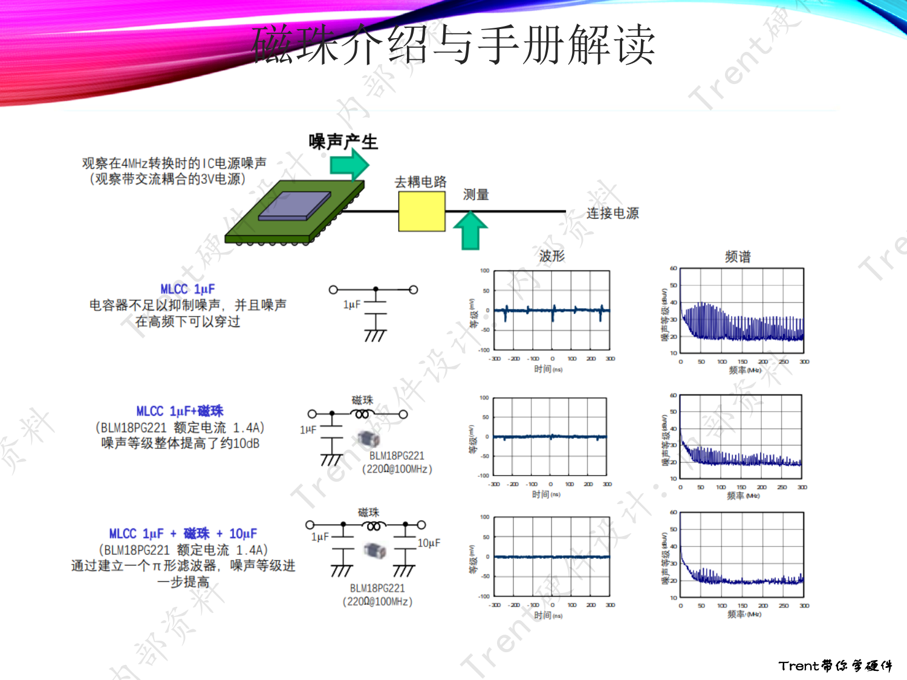

# 磁珠与电容组合滤波对比

**来源：**《基础篇-03.pdf》第50页。课程展示图及波形，非用户实验；本次用于配合已学磁珠应用，不扩展为完整π型滤波器设计课程。

## 按图比较三种情况

1. **单个1 µF MLCC旁路**：图中仍有噪声传出。
2. **1 µF电容加串联磁珠**：图标为BLM18PG221、220 Ω @100 MHz、额定1.4 A，课程称噪声等级整体约改善10 dB。
3. **再加10 µF电容构成π型网络**：图示噪声进一步减小。

约10 dB是**这张课堂图的结果描述**；原PPT未在此页给出可完整复现的源/负载阻抗、测量带宽及布板条件，不能写成任何磁珠都必然有10 dB改善。额定1.4 A也不是图中实际负载电流。

## 为什么组合可能更有效？

并联电容提供局部高频回流，串联磁珠提高通向外部供电网络的高频阻抗，阻性损耗帮助耗散部分噪声能量。不是“磁珠阻抗越大越好”或“电容越多越好”：必须同时看电源压降、实际频带、偏置后的参数以及网络谐振。

**边界提示：** 组合网络在某些频率也可能出现谐振峰；这是需要检查的工程条件，不是本图已经证明出现的故障。厂家核验：[ADI AN-1368](https://www.analog.com/en/resources/app-notes/an-1368.html)。

带走的结论：**比较同条件下的整个网络响应，不能用单个100 MHz阻抗数值代替实际滤波效果。**

返回[[B05-磁珠介绍与手册解读]]。
