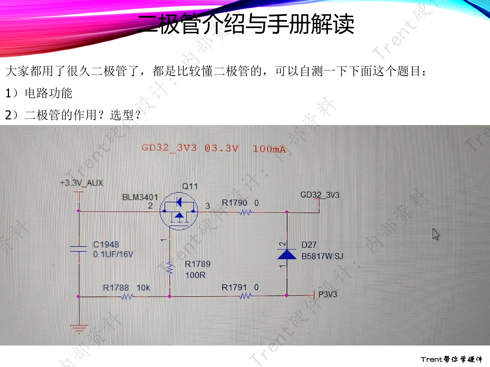

# GD32供电二极管D27读图

**来源：**《基础篇-03.pdf》第65页课程自测图。本次是AI辅助读图，没有用户答题和实板测试，不虚构课程给出的完整答案。

## 先只看本节学到的二极管部分

图中D27标为**B5817W:SJ**：下端1脚接P3V3，上端2脚接GD32_3V3，符号的横线位于上端。

按图，允许的正向路径是**P3V3→D27→GD32_3V3**；若P3V3比负载节点高到足以产生所需正向电流，D27可向负载供电。若负载节点反而较高，D27反偏，抑制电流沿此支路回灌P3V3；真实器件仍需考虑漏电及额定反向条件。

D27旁的另一路经过Q11与R1790（图中0 Ω）。它提示这是含多个供电路径的电路，不能只看一只二极管就保证完整电源优先级、无缝切换或所有状态下完全防回灌。**Q11的极性、体二极管及完整控制时序留待相应MOS课程，不在这里提前算已学。**

## 为什么必须看VF？

当由P3V3经过D27供电时，负载端电压约为：

$$V_{GD32}\approx V_{P3V3}-V_F-I R_{路径}.$$

图上“3.3 V、100 mA”是课程标注，不能据此保证负载实际始终得到3.3 V。需要依据该负载的允许供电范围、真实电流、启动需求和D27的VF曲线，判断剩余电压是否足够。此处不编造GD32具体型号及欠压门槛，也不把东芝1SS187的VF数值套到D27上。

## 若选或替换D27，要查什么？

- 按实际BOM核对厂家、完整型号、引脚与封装；B5817W与资料中的B5817WS不能只因名字接近就认定完全同料。
- 查正常电流和温度下VF，计算负载端最低电压与导通损耗。
- 查可能反向承受的电压、反向漏电以及另一供电路径的状态。
- 查启动时电容充电等引起的实际浪涌，核对脉冲条件和温升；“额定浪涌大”不是器件需要上游主动提供这么大电流。

带走的结论：**先沿A→K辨认供电方向，再用真实VF核对负载电压；不要把额定承受能力当负载需求。**

返回[[B06-二极管介绍与手册解读]]。
