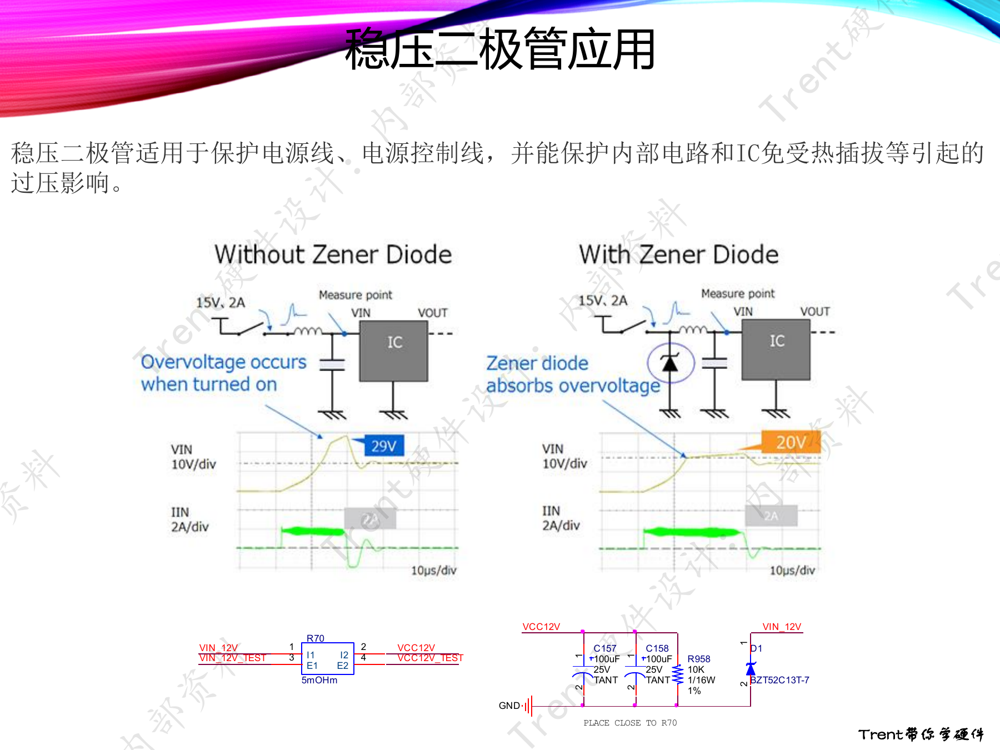

# 热插拔稳压钳位与LC滤波的区别

**来源：**《基础篇-03.pdf》第88页及[用户分享对话《高频去耦解释》](https://chatgpt.com/share/6ade013d-fa14-83e9-8eeb-28ff7c9790f7)。这是课程图、本人理解与AI解释的核对记录，非本人实板测量。

## 先把同一页的两组图分开

**上方概念/波形图：** 标15 V、2 A，左侧无稳压管时电压峰值标29 V，右侧增加稳压管后标20 V；有串联电感符号和输入侧电容。这是该课程图的效果展示，不是所有稳压管的通用钳位数值。

**下方原理图：** 有VIN_12V、VCC12V、5 mΩ的R70、C157/C158两只100 µF/25 V钽电容、R958=10 kΩ和D1=BZT52C13T-7。截图没有画出上方相同的串联电感，且不能仅凭网名断定VIN_12V和VCC12V在PCB所有位置完全等电位。R70是毫欧级元件，不是可以随意套用作稳压限流的千欧电阻。

因此，上方20 V与下方13 V标称值不构成“同一个管在同一条件下的保证”；需要完整电路、BOM、脉冲和测点才能确定实际关系。

## 分享对话中本人原话

> 我是不是可以理解 首先一个29幅的剑锋脉冲电压信号进入 假设我的稳压二极管工作把这个信号稳定在了16v 然后电感对于高频的噪声又呈现很高的阻性削弱噪声的幅度 然后再对于这个高频的噪声电容呈现一个低阻抗的通路 噪声直接从电容的支路溜走了

保留输入原文，“29幅的剑锋”按语境理解为29 V尖峰，但**16 V是本人假设**，不是课程图测得值。

## 对话AI解释的要点及本次核对

| 内容 | 保留与限定 |
|---|---|
| 稳压管限制过压 | 原意正确，但实际钳位取决于脉冲电流、动态阻抗、温度、源阻抗与寄生，不保证精确16 V |
| 电感削弱高频扰动 | 在合适频段利用感抗、阻碍电流快速变化；不是将感抗直接等同纯电阻发热 |
| 电容旁路高频 | 合适频段内提供局部回路，降低节点扰动；不是电流进地后能量消失 |
| “首先、然后、最后” | 可作讲解顺序，实际同一网络里的器件同时响应，不能当固定先后时序 |
| 上下两图 | 分享回答已提醒不是同一完整电路，本次保留该关键边界 |

## 一个可操作的分析顺序

1. 标出正常工作电压和被保护端允许电压范围，确认稳压管正常状态下不会过量导通。
2. 确认过压来源、波形、持续时间及源阻抗，估计实际分流电流。
3. 查器件在相应电流、温度下的电压/动态阻抗与脉冲承受条件，不能只用室温VZ。
4. 计算/核查稳压管耗散及外围电容、电感、走线的实际作用，再在相同测点和条件下比较波形。

普通稳压管的稳态功耗值不能直接当TVS脉冲能力，具体瞬态保护要求仍需具体器件数据。这里不提前计为已经学完TVS专题。

**本例结论：** 稳压钳位与LC滤波是不同作用，可以互相配合；课程图和假设数字必须分开，不以“标称几伏”保证所有尖峰都被压到该值。

返回[[B06-稳压二极管介绍与手册解读]]；滤波/去耦基础见[[B03-电容器件手册解读与选型应用]]。
