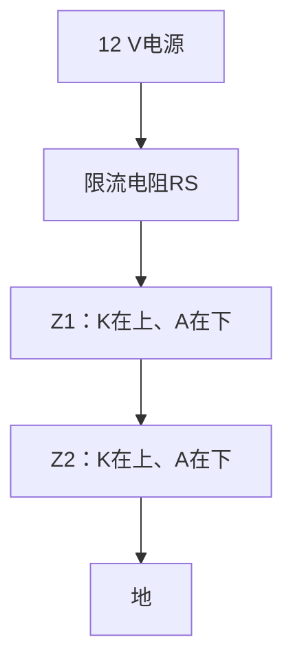

# 稳压管串联的电压相加与电流交集

来源为课程第87页提出的串联问题，结合电路电流关系讲解。**以下电压和可用电流范围全是假设，不是某两个真实料号的保证规格，也非用户实测。**

## 假设与接法

同一串联支路中Z1、Z2都按反向稳压方向连接：每只电流进入其K、离开其A；Z1的A连接Z2的K，Z2的A接地。上游12 V通过限流电阻RS供给该串联支路，暂不接其他负载。

图为AI连接示意，不是原课件电路图。

| 假设器件 | 该应用精度与温度条件下的可用电流范围 | 近似稳压值 |
|---|---|---|
| Z1 | 2–10 mA | 5.1 V |
| Z2 | 5–20 mA | 3.3 V |

这些范围**不是IZT**，而是假设已依据各管的精度与热条件得到的可用区间。

## 先走完整流程

**第一步：相加电压。** 两只都在有效稳压区且先忽略误差时，总电压约5.1+3.3=8.4 V。

**第二步：求共同可用电流。** 同一电流流过两只，既要满足Z1的2–10 mA，也要满足Z2的5–20 mA，因此交集为**5–10 mA**。不是简单取较小测试电流，也不是由某只管自动“输出”一个固定电流。

**第三步：用外部电路确定电流。** 若选RS=470 Ω，名义稳态估算：

$$I\approx\frac{12-8.4}{470}=7.66\ \mathrm{mA}.$$

7.66 mA位于两者的共同区间内，因此**名义电流这一步通过**。还未完成真实选型。

**第四步：逐个算耗散。**

- Z1约5.1×7.66 mA=39.1 mW。
- Z2约3.3×7.66 mA=25.3 mW。
- RS约(12−8.4)×7.66 mA=27.6 mW。

分别与各器件在实际温度、安装条件及所取裕量下的允许功耗比较；不能仅比较两管功率之和。

## 真正选型还要补哪些条件？

计入输入范围、电阻允差、各管VZ允差、动态阻抗和温漂，重算电流两端及各自最大耗散。若总稳压节点还并接负载，限流电阻电流要分成负载电流与稳压支路电流，即IR=IL+IZ，不能继续照搬无负载公式的结果。

**带走的结论：电压可近似相加；实际电流由外部电路决定，可用电流要取两只允许范围的交集。**

返回[[B06-稳压二极管介绍与手册解读]]。
